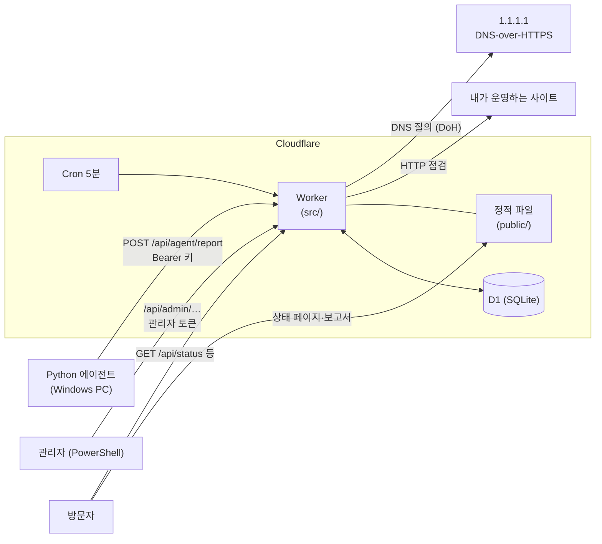

# Uptime Monitor · 서비스 상태 진단

[](https://github.com/Taetaeeee/uptime-monitor/actions/workflows/test.yml)

가상 회사의 웹 서비스와 사내 시스템을 5분마다 점검하고, 장애를 감지·기록하고,
가동률과 장애 이력을 **공개 상태 페이지**와 **월간 가용성 보고서**로 보여 주는 포트폴리오 프로젝트입니다.

- **상태 페이지 (라이브):** https://status-monitor.nalzzoaleph26.workers.dev
- **월간 보고서:** https://status-monitor.nalzzoaleph26.workers.dev/report.html

> 점검 대상 서비스와 회사는 모두 가상입니다(실제 점검 대상은 내가 운영하는 사이트 하나). 화면의 대부분은 **데모 데이터**이며, 무엇이 실제이고 무엇이 가짜인지는 [아래 표](#실제-데이터와-가짜-데이터)에 정리했습니다.

## 무엇을 하나

| 기능 | 내용 |
|---|---|
| 외부 점검 | Cloudflare Worker 예약 실행(Cron, 5분)으로 HTTP 상태 코드·응답 시간·키워드, DNS(DNS-over-HTTPS로 이름 풀림·기대값) 점검. 도메인 만료는 판정 로직만 ([한계](#알려진-한계와-다음-과제) 참고) |
| 내부 점검 | Windows PC의 Python 에이전트가 ping·TCP 포트·SSL 만료·디스크·서비스 상태를 측정해 API로 보고 (바깥으로만 연결) |
| 장애 판정 | 2회 연속 실패 → 장애, 1회 성공 → 복구. 상태가 바뀔 때만 알림 기록 |
| 장애 이력·보고서 | 장애 1건마다 첫 실패·판정·복구 시각, 감지 시간(MTTD)·복구 시간(MTTR), 사후 보고서 5항목 |
| 계획 작업 | 미리 등록한 작업 시간의 점검은 장애로 보지 않고 가동률에서 제외 |
| 상태 페이지 | 한 줄 상태 띠와 LIVE 표시(다음 점검까지 카운트다운), 요약 카드·최근 알림, 서비스 현황(30일 막대·"N분 전 점검"·상태가 바뀐 카드 강조), 카드를 누르면 상세 팝업(최근 24시간 응답 시간·측정값 그래프, 30일 가동률, 30일 일평균 응답), 장애 이력. 점검 회차 직후 자동으로 새로 불러옴 |
| 월간 보고서 | 대상별 가동률·SLA(99.9%) 달성·에러 버짓·장애 지표, 인쇄/PDF 저장 |
| 화면 테마 | 어두운 화면(기본, 업무용)과 밝은 화면(보고·공유용)을 헤더의 토글 스위치로 전환, 고른 값은 브라우저에 저장. 주소 끝 `?theme=light`로 열면 처음부터 밝은 화면 |

## 구성



점검 1회의 흐름 (Cron과 에이전트 보고가 같은 경로 `src/record.js`를 사용):

```
측정 → 판정(순수 함수) → 계획 작업 확인 → 상태 전이(장애/복구)
    → [결과 + 상태 + 장애 이력] 한 batch 저장 → 알림(log 채널) → 일별 집계(KST)
```

## 기술

- **Cloudflare Workers** (Cron + API + 정적 파일), **D1**(SQLite), **wrangler**
- 화면: 빌드 도구 없는 HTML/CSS/JS
- 판정·계산 로직은 순수 함수로 분리해 `node --test`로 테스트
- 에이전트: Python 3 표준 라이브러리만 사용
- 테스트: JS 106개, Python 22개

## 주요 설계 판단

| 판단 | 이유 |
|---|---|
| 장애는 **2회 연속 실패**, 복구는 **1회 성공** | 일시적 흔들림으로 인한 오탐·알림 피로를 줄이고, 복구는 빨리 알려 장애 시간이 부풀지 않게 (감지는 최대 5분 늦어짐) |
| 점검 시각을 **5분 회차로 내림**해 저장 | Cron이 정각보다 몇 초 늦게 실행됨(실측 :12초). 회차 단위로 묶어 집계·비교 |
| 저장은 **UTC**, 하루·한 달은 **KST** | 기준을 하나로 저장하고, 사람이 보는 경계는 한국 시간으로 (서머타임 없음) |
| 에이전트는 **측정만**, 판정은 **서버** | 기준값을 한곳에서 관리, 에이전트가 여러 대여도 판정 일관 |
| 에이전트는 **바깥으로만 연결(push)** | PC에 들어오는 포트를 열지 않음. 대신 에이전트가 멈추면 보고가 끊김(아래 한계 참고) |
| 결과·상태·장애 이력을 **한 batch**, 알림은 **저장 후** | 기록끼리 어긋나지 않게 하고, 알림 실패가 점검 기록을 막지 않게 |
| 모든 기록에 **출처(source)** + DB CHECK 제약 | 실제·가짜 데이터가 섞여 보이지 않게. 시뮬레이터 보고는 시뮬레이터 대상에만 기록 |
| 가동률은 **내림** 표시, 기간 가동률은 **점검 수 합계**로 | 99.99…%가 100%로 보이지 않게, 날짜별 % 평균의 왜곡 방지 |
| 계획 작업 중 점검은 **기록하되 가동률·판정에서 제외** | SLA의 일반 규칙. 남용 방지를 위해 최대 24시간·소급 등록 금지 |
| 에이전트 키와 관리자 토큰 **분리**, 타이밍 안전 비교 | 최소 권한, 키 추측 공격 방지 |

## 실제 데이터와 가짜 데이터

모든 기록(점검 결과·상태·알림·장애·집계·작업)에 출처가 남고, 화면과 보고서에 표시됩니다.
보고서는 출처별로 따로 보여 주며 **실제와 가짜를 합친 숫자는 만들지 않습니다.**

| 출처 | 무엇 | 어떻게 들어가나 | 화면 표시 |
|---|---|---|---|
| `real` | **고쳐라! 웹게임**(`gochyeora.pages.dev`, 내가 운영하는 사이트)의 HTTP 점검과 DNS 점검 | Worker Cron, **5분마다 실제 점검** (2026-11-11부터) | 표시 없음 |
| `real` | 관리자가 등록한 '모든 대상' 계획 작업 | 관리자 API | 표시 없음 |
| `sample` | 가상 서비스 3개(ERP·그룹웨어·고객센터)의 점검 결과·30일 집계·장애 7건·보고서·알림·계획 작업, 도메인 만료 데모 1개(만료까지 41일) | `seed/sample.sql` (다시 실행하면 지우고 새로 넣음). 배포본은 **Worker가 매일 KST 04:00 회차에 자동으로 다시 넣어** 날짜를 오늘 기준으로 맞춤 | **데모 데이터**, 카드에 "매일 04:00 갱신" |
| `simulator` | 가상 내부 장비 5개(코어 스위치·DB 서버·파일 서버 디스크·인증서·ERP 배치)의 측정값과 그로 인한 장애·알림 | `seed/simulator-monitors.sql`로 대상 등록 → `agent/agent.py --simulate`로 시나리오 전송 | **시뮬레이터** |

- 가상 서비스의 주소는 모두 `.invalid`(RFC 2606 예약 도메인)라 실제로 접속될 수 없고, 비활성이라 점검되지도 않습니다.
- 데모 자동 갱신을 매시간이 아니라 **하루 1회**로 둔 이유: 1회에 약 750행을 쓰는데, D1 무료 쓰기 한도는 같은 계정의 다른 프로젝트와 함께 쓰는 것으로 알고 있어서(공식 문서에서 확인할 부분) 부담을 최소로 했습니다. 다시 넣을 때마다 데모 서비스·장애 번호가 바뀌어, 전날 복사해 둔 데모 장애 링크는 열리지 않을 수 있습니다.
- 에이전트의 실제 모드는 이 PC에서 `--dry-run`으로만 확인했고, 실제 측정값은 아직 보내지 않습니다.

## 폴더 구조

```
src/            Worker 코드
  index.js        진입점 (Cron, HTTP 경로)
  checker.js      HTTP 측정        judge.js       HTTP·DNS·도메인 만료 판정
  dns.js          DNS 측정 (DNS-over-HTTPS)
  agent-judge.js  에이전트 보고 검증·판정
  state.js        장애 판정(상태 전이)   record.js  기록 공용 경로
  notify.js       알림 발송         channels/log.js  log 채널 (D1 기록)
  aggregate.js    일별 집계·가동률   report.js  월간 보고서 계산
  incident.js     장애·계획 작업 계산  time.js   회차 시각
  ingest.js       에이전트 보고 API  admin.js  관리자 API
  api.js          공개 조회 API     auth.js   토큰 확인   db.js  SQL 모음
  demo.js         데모 시드 매일 자동 갱신 (demo-sql.js가 seed/sample.sql을 글자로 불러옴)
public/         상태 페이지, 장애 상세, 월간 보고서 (HTML/CSS/JS)
migrations/     D1 스키마 (0001 ~ 0007)
seed/           가짜 데이터 (sample.sql, simulator-monitors.sql)
agent/          Python 에이전트 + 시뮬레이터 시나리오 + 테스트
test/           node --test (가짜 D1: Node 내장 SQLite에 실제 마이그레이션 적용)
```

## 실행 방법 (Windows PowerShell)

> PowerShell 실행 정책 때문에 `npm`·`npx` 대신 `npm.cmd`·`npx.cmd`를 씁니다.

### 테스트
```powershell
npm.cmd install
npm.cmd test                                     # JS 110개
python -m unittest discover -s agent\tests       # Python 22개
```

### 처음 배포
```powershell
npx.cmd wrangler login                           # 계정 인증 (직접)
npx.cmd wrangler d1 create status-monitor-db     # 나온 database_id를 wrangler.jsonc에
npm.cmd run db:migrate:remote                    # 마이그레이션 0001 ~ 0007
npx.cmd wrangler d1 execute status-monitor-db --remote --file=seed/sample.sql
npx.cmd wrangler d1 execute status-monitor-db --remote --file=seed/simulator-monitors.sql
npx.cmd wrangler secret put AGENT_API_KEY        # 에이전트 키 (직접 생성)
npx.cmd wrangler secret put ADMIN_TOKEN          # 관리자 토큰 (에이전트 키와 다른 값)
npm.cmd run deploy
npx.cmd wrangler tail                            # 5분마다 점검 로그
```

비밀 값을 만드는 예:
```powershell
$bytes = New-Object byte[] 32; [Security.Cryptography.RandomNumberGenerator]::Create().GetBytes($bytes); [Convert]::ToBase64String($bytes)
```
비밀 값은 코드·저장소에 넣지 않습니다. 로컬은 `.dev.vars`(`.gitignore` 대상, 예시는 `.dev.vars.example`).

### 실제 사이트 점검 켜기
```powershell
npx.cmd wrangler d1 execute status-monitor-db --remote --command "UPDATE monitors SET is_active = 1 WHERE url IN ('https://gochyeora.pages.dev', 'dns://gochyeora.pages.dev')"
```

### 에이전트 · 시뮬레이터
```powershell
python agent\agent.py --config agent\config.example.json --once --dry-run   # 이 PC 측정만 (전송 없음)
$env:AGENT_API_KEY = "<에이전트 키>"
python agent\agent.py --simulate agent\scenarios\db-outage.json --api-url https://<Worker 주소>/api/agent/report
```
자세한 내용: [agent/README.md](agent/README.md)

### 관리자 API (보고서 작성 · 계획 작업)
```powershell
$b = "https://<Worker 주소>"
$h = @{ Authorization = "Bearer $env:ADMIN_TOKEN" }
$body = @{ summary = '요약'; root_cause = '원인'; action = '조치'; prevention = '재발 방지' } | ConvertTo-Json
Invoke-RestMethod -Method Put -Uri "$b/api/admin/incidents/<장애 번호>/report" -Headers $h `
  -ContentType 'application/json; charset=utf-8' -Body ([Text.Encoding]::UTF8.GetBytes($body))

$w = @{ monitor_id = <대상 번호>; title = '작업 이름'; starts_at = '2026-11-20T22:00:00+09:00'; ends_at = '2026-11-20T23:00:00+09:00' } | ConvertTo-Json
Invoke-RestMethod -Method Post -Uri "$b/api/admin/maintenance" -Headers $h `
  -ContentType 'application/json; charset=utf-8' -Body ([Text.Encoding]::UTF8.GetBytes($w))
Invoke-RestMethod -Method Delete -Uri "$b/api/admin/maintenance/<작업 번호>" -Headers $h
```
시각에는 반드시 시간대(`+09:00` 또는 `Z`)를 붙입니다. 없으면 거부합니다(한국 시간/UTC 혼동 방지).

## API

| 경로 | 인증 | 내용 |
|---|---|---|
| `GET /api/status` | 없음 | 상태 페이지 전체 (서비스·30일 막대·장애 이력·알림·계획 작업), 60초 캐시 |
| `GET /api/incidents/:id` | 없음 | 장애 상세·보고서·타임라인 |
| `GET /api/reports/monthly?month=YYYY-MM` | 없음 | 월간 가용성 보고서 (없으면 이번 달) |
| `GET /api/monitors/:id/history?hours=24` | 없음 | 상세 팝업 그래프용 최근 기록 (1~48시간), 60초 캐시 |
| `POST /api/agent/report` | 에이전트 키 | 에이전트 측정값 보고 (중복 회차는 건너뜀) |
| `PUT /api/admin/incidents/:id/report` | 관리자 토큰 | 보고서 작성·수정 |
| `POST /api/admin/maintenance` · `DELETE /api/admin/maintenance/:id` | 관리자 토큰 | 계획 작업 등록·취소 |

공개 응답에는 점검 대상의 주소(URL)를 넣지 않습니다.

## 알려진 한계와 다음 과제

- **에이전트 무응답 감지 없음:** 에이전트가 멈추면 보고가 끊길 뿐 장애로 판정되지 않습니다.
- **정밀도 5분:** 점검 간격 때문에 감지·복구 시간과 장애 시간은 5분 단위입니다.
- **Cron 실행 지연:** 실행 시각이 정각보다 몇 초 늦어(실측 12초) 회차 내림으로 보정했습니다. 5분 넘게 늦으면 다음 회차로 묶입니다.
- **로컬 Worker 실행 불가:** 개발 PC의 Windows 스마트 앱 컨트롤이 `workerd.exe`를 차단해 `wrangler dev`를 쓰지 못했습니다. 보안 설정을 끄지 않고, D1과 같은 SQLite(Node 내장)에 실제 마이그레이션을 적용한 가짜 D1로 Cron·API 흐름 전체를 테스트하고 원격에서 확인했습니다.
- **도메인 만료는 판정 로직만:** 내 도메인이 없어서 실제 만료일 조회(RDAP/WHOIS)는 만들지 않았습니다. `judgeDomainExpiry`(30일 전부터 경고)를 가짜 날짜로 테스트하고, 화면에는 데모 대상 1개로만 보여 줍니다.
- **SLA 목표는 하나(99.9%):** 대상별 목표, CSV 내보내기, 보고서 자동 발송은 없습니다.
- **알림 채널은 log 하나:** 채널 구조(`{ name, send() }`)는 교체 가능하게 나눠 두었습니다. 외부 메신저는 쓰지 않습니다.
- **실제 데이터는 아직 짧음:** 고쳐라! 웹게임(HTTP·DNS) 실제 점검은 2026-11-11부터 시작해서, 30일 막대·월간 보고서의 실제 구간은 아직 며칠뿐입니다.
- **실제 PC 측정값은 보내지 않음:** 에이전트의 실제 모드는 `--dry-run`으로만 확인했습니다(내 PC 정보를 공개 페이지에 올릴지 정하지 않음).

## 공식 문서에서 다시 확인할 부분

> 확인 완료: Worker 안에서 DoH(`cloudflare-dns.com`) 조회가 동작함 — 2026-11-11 실제 DNS 점검을 켠 첫 회차에서 응답 49ms·레코드 2개 기록.

Cloudflare 설정은 버전에 따라 바뀔 수 있어, 확인하지 못한 것은 추측하지 않고 표시해 두었습니다.

- 무료 플랜의 Cron 개수 제한, D1 쓰기 한도 수치
- D1 `batch`의 트랜잭션 동작
- 정적 파일(`assets`)의 `.html` 리다이렉트 등 기본 동작 (배포본에서 `/incident.html` → `/incident` 307 확인)
