# Uptime Monitor · 서비스 상태 진단

[](https://github.com/Taetaeeee/uptime-monitor/actions/workflows/test.yml)

실제로 운영 중인 웹 서비스를 5분마다 점검하고, 장애를 감지·기록하고,
가동률과 장애 이력을 **공개 상태 페이지**와 **월간 가용성 보고서**로 보여 주는 포트폴리오 프로젝트입니다.

- **상태 페이지 (라이브):** https://status-monitor.nalzzoaleph26.workers.dev
- **월간 보고서:** https://status-monitor.nalzzoaleph26.workers.dev/report.html

> 화면에는 **실제로 운영 중인 서비스의 실제 점검 기록만** 있습니다: 내가 운영하는 사이트(고쳐라!)와 팀이 만든 채팅(Keychats, 화면 이름 "사내 메신저").
> 2026-11-19까지는 공개 데이터셋 재생·에이전트 시뮬레이터 데이터를 출처 표시와 함께 섞어 보여 줬지만, 방침을 바꿔 배포 DB에서 모두 지웠습니다([가짜 데이터 정리](#실제-데이터와-가짜-데이터)).

> **서비스 묶음과 대시보드 (2026-11-19~20, 14단계):** 점검(HTTP·DNS·DB 상태)을 서비스(고쳐라!·Keychats) 단위로 묶었습니다(마이그레이션 0015). 첫 화면은 서비스 단위 대시보드로 바꾸고, 서비스 상세 화면을 더했으며, 점검별 카드·장애 이력·운영 근거는 각각 별도 페이지로 옮겼습니다. 0015 원격 적용 → 배포 → 라이브 확인까지 했습니다. 아래 스크린샷은 새 화면입니다(2026-11-20).
>
> **문서 기준 (2026-11-19):** 원격 D1에서 가짜 데이터를 지웠고(백업 후 삭제, 전후 건수 대조), 재생 실행 코드·화면의 재생·데모 표시·seed를 정리해 같은 날 배포했습니다. 배포는 커밋 내용만 담은 깨끗한 폴더에서 했습니다(커밋하지 않은 작업 파일이 올라가지 않게). 라이브에서 `/api/status`의 대상 5개가 모두 `real`이고 재생 필드가 없음, 월간 보고서 묶음이 `real` 하나, 삭제한 `/api/incidents/41`이 404, 데스크톱 상태 페이지에 콘솔 오류가 없음을 확인했습니다. 이 정리 뒤의 CI 실행과 375px 모바일 화면은 확인하지 못했습니다.

## 처음 보시는 분께: 3분 확인 경로

1. **상태 페이지** — 맨 위 상태 띠는 실제 점검 대상의 현재 상태를, 서비스 카드는 대상별 30일 막대와 마지막 점검 시각을 보여 줍니다.
2. **서비스 상세** — 카드를 누르면 팝업(24시간 그래프, 30일 가동률)이 나옵니다.
3. **장애 대응 흐름** — [장애 훈련 기록](#장애-훈련-기록)에 "장애 → 알림 → 복구 → 사후 보고서"를 일부러 낸 장애로 확인한 기록(PDF)이 있습니다. 훈련 기록은 실제 서비스가 아니라서 화면·DB에서는 지웠습니다.
4. **월간 보고서** — 대상별 가동률·SLA·에러 버짓을 보여 줍니다.
5. **검증 자료** — [검증자료 안내(reviewer-guide)](docs/portfolio/reviewer-guide.md)에서 질문별 근거 위치와 한계를 찾을 수 있습니다.

## 30초 요약

- **무엇:** 서비스를 5분마다 점검해 장애를 감지·기록하고, 가동률과 장애 이력을 공개 상태 페이지·월간 보고서로 보여 주는 운영 도구. Cloudflare Workers + D1, 화면은 빌드 도구 없는 HTML/JS, 내부 점검은 Python 에이전트.
- **실제로 돌고 있는 것:** 내가 운영하는 사이트(고쳐라!)와 팀이 만든 채팅(Keychats)을 5분마다 실제 점검하고, 장애 훈련으로 "장애 → 알림 → 복구 → 사후 보고서" 흐름을 실제 환경에서 확인했습니다.
- **가짜 데이터:** 배포본에는 없습니다. 가짜 데이터는 테스트 고정 자료(`test/fixtures/`)와 로컬 시험용 에이전트 시뮬레이터에만 있고, 실제가 아닌 기록이 섞이면 화면이 '실제 아님'으로 따로 표시합니다.
- **검증:** 판정·계산 로직을 순수 함수로 분리해 JS 455개·Python 22개 테스트를 두었습니다(2026-11-20 로컬 확인). 푸시마다 CI(Windows·Ubuntu)에서 다시 실행합니다. 판정 규칙의 성능은 설계에 쓰지 않은 데이터로 따로 측정했습니다(서버 지표에서 탐지율 44.7%, 오탐 시계열당 하루 0.81건). 이 수치가 이 서비스의 HTTP 점검 성능은 아니라는 점까지 [적어 두었습니다](#판정-규칙-성능-측정).
- **한계:** 에이전트 무응답 감지는 대상마다 켜야 하고 아직 켠 대상이 없음, 점검 정밀도 5분, 도메인 만료는 판정 로직만 ([전체 한계](#알려진-한계와-다음-과제)).

## 화면

라이브 사이트의 실제 점검 기록으로 찍었습니다 (2026-11-25, 서비스 10개, 1440px · 휴대폰은 390px). 동료 서비스 이름은 사용자가 공개를 허락해 그대로 두었습니다.

| 대시보드 (어두운 화면, 기본) | 대시보드 (밝은 화면) |
|---|---|
| 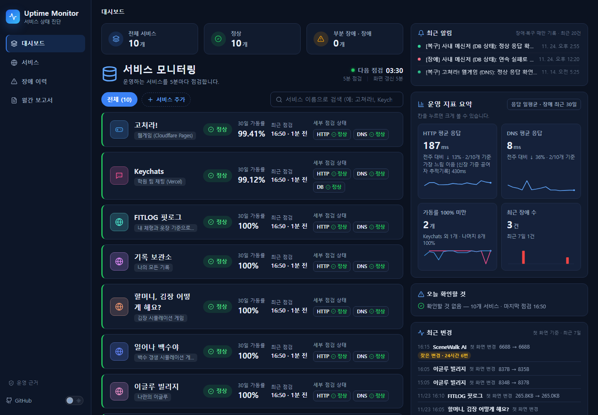 | 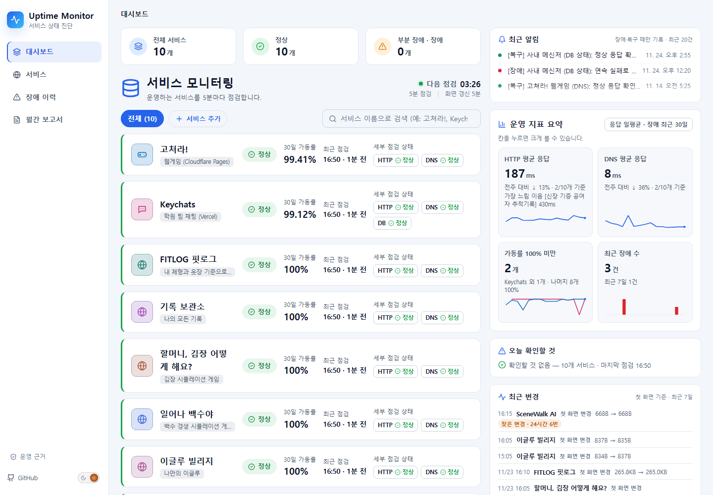 |

| 서비스 상세 (Keychats) | 서비스 페이지: 점검별 카드 |
|---|---|
| 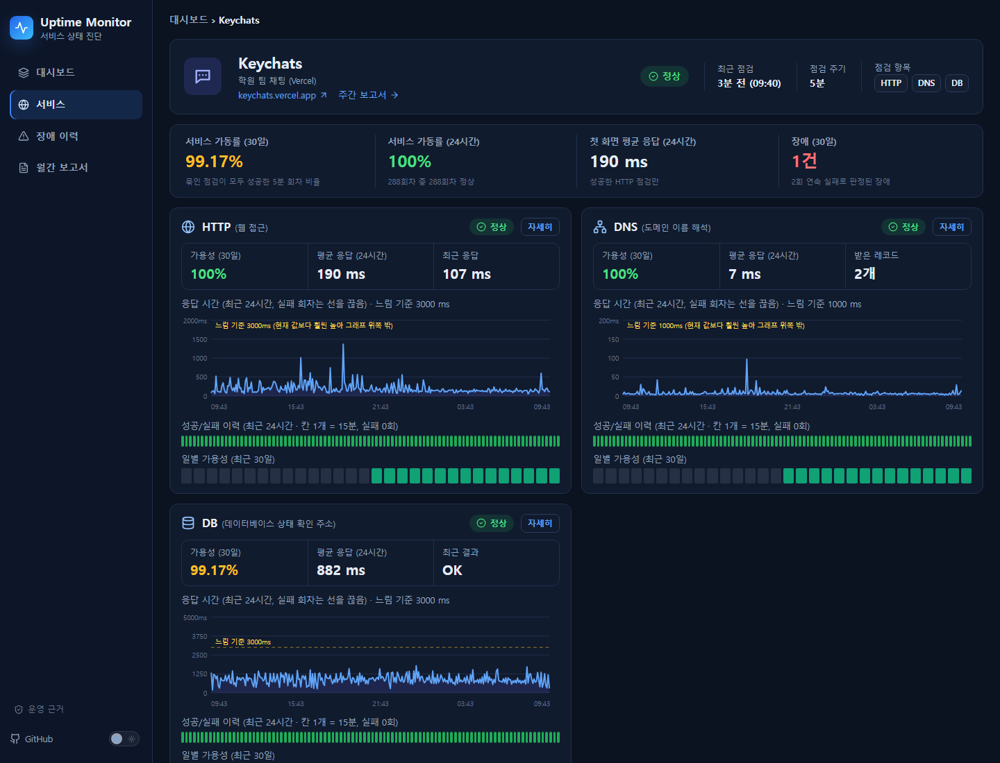 | 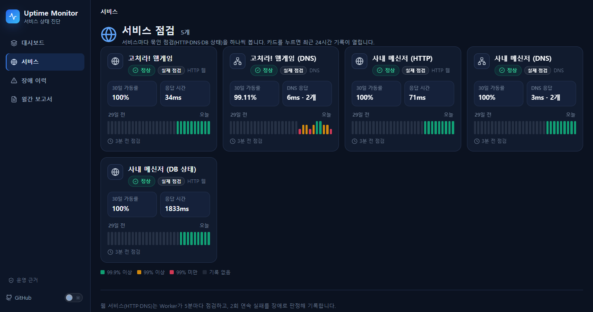 |

| 서비스 추가 팝업 (빈 입력칸) | 운영 지표 확대 팝업 (HTTP 평균 응답 · 겹쳐 보기) |
|---|---|
| 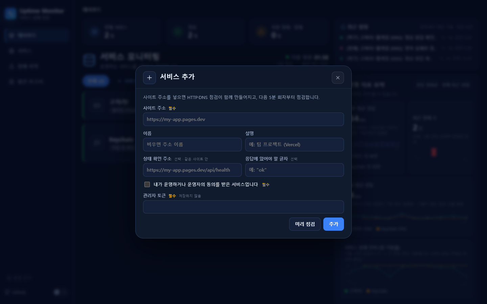 | 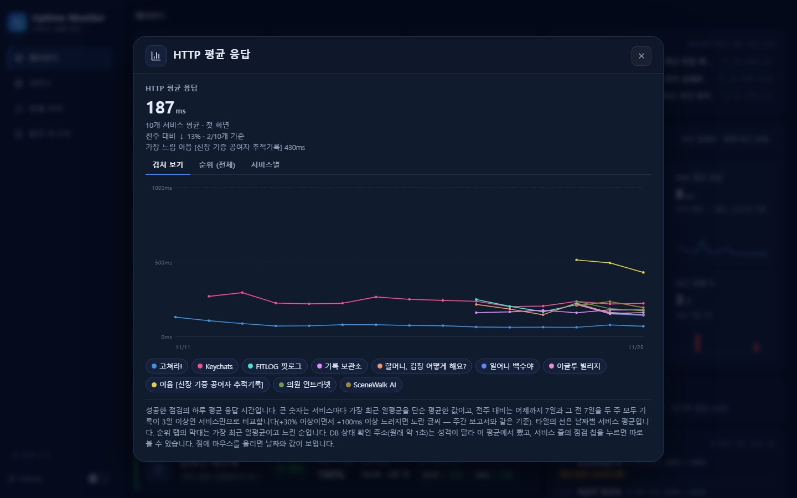 |

| 휴대폰 (390px) | 월간 가용성 보고서 |
|---|---|
| 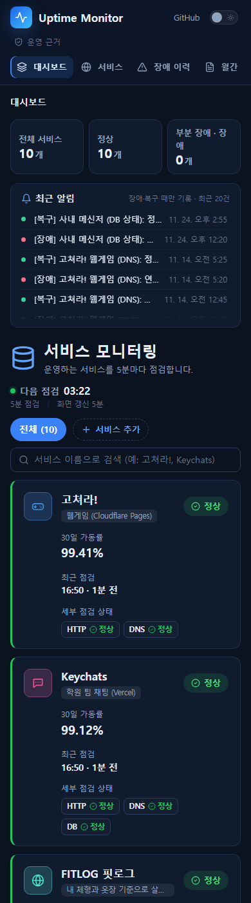 | 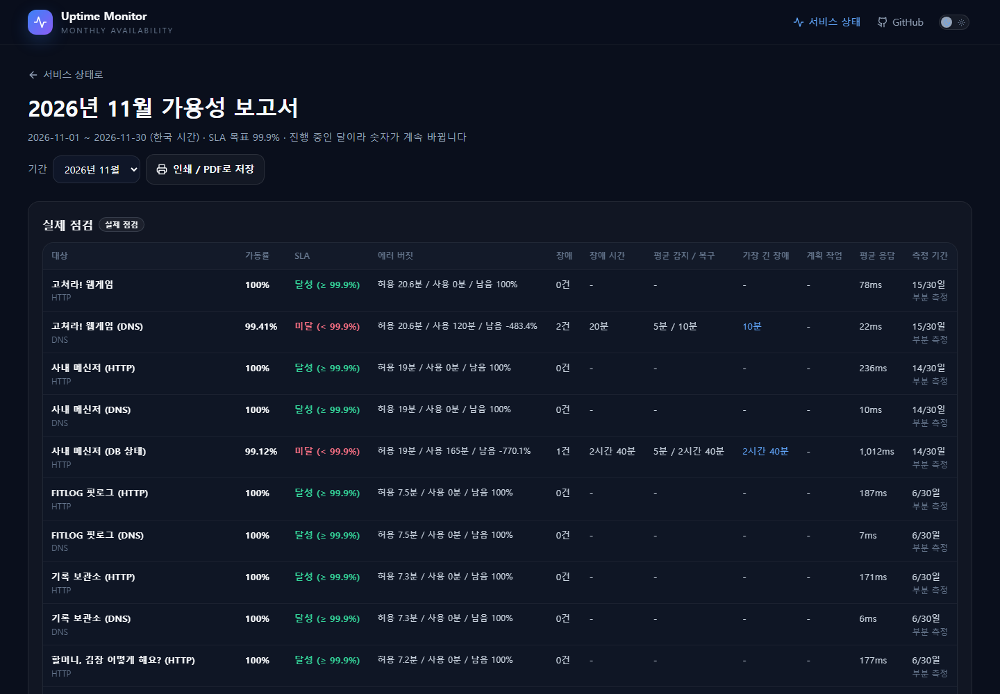 |

| 서비스 주간 점검 보고서 (Keychats, 11-16~22) | 운영 근거: 데이터 보존 정책 |
|---|---|
| 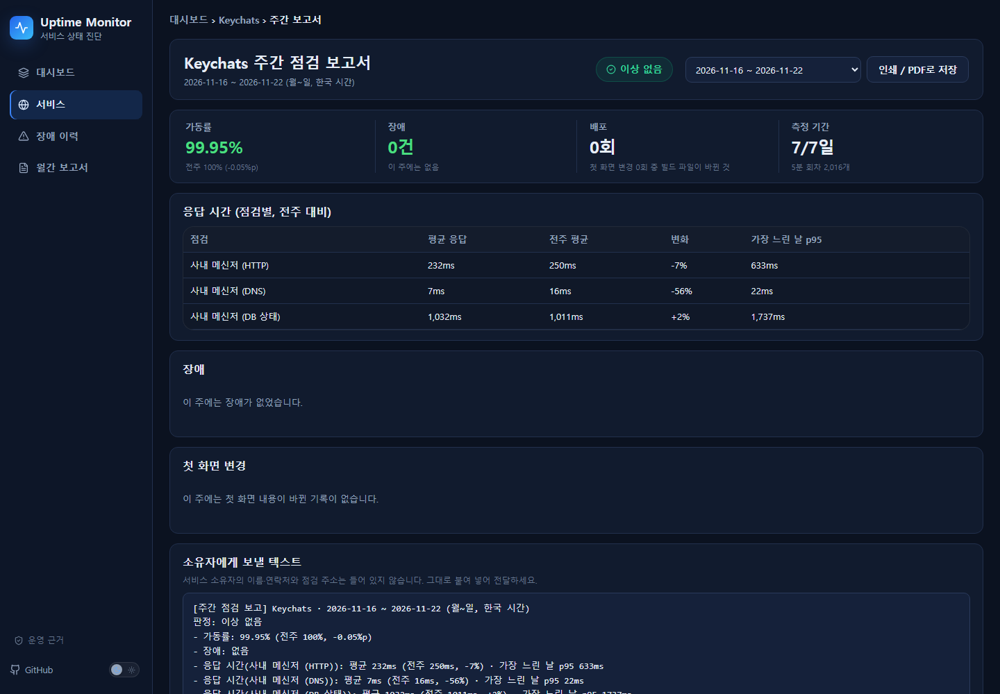 | 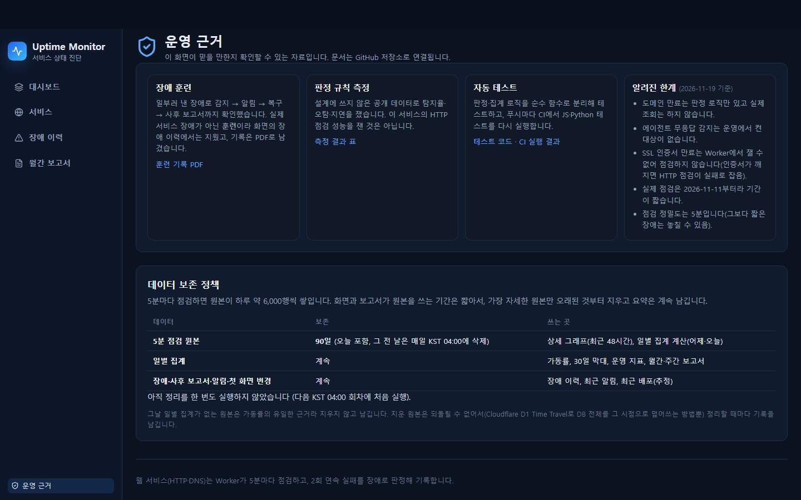 |

월간 보고서의 고쳐라! DNS '미달'(99.11%)은 실제 기록입니다(DNS 조회 오류 장애 2건, 각 10분 — 원인은 아직 확인하지 않음).

**장애 훈련 당시 화면 (2026-11-12):** 아래 두 장은 [장애 훈련](#장애-훈련-기록) 기록입니다. 훈련 대상은 실제 서비스가 아니라서 지금 DB·화면에서는 지웠고, 이 화면과 PDF로만 남아 있습니다.

| 장애 상세: 요약 지표와 타임라인 | 장애 상세: 사후 보고서 |
|---|---|
| 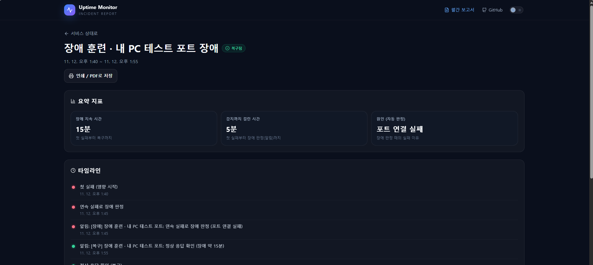 | 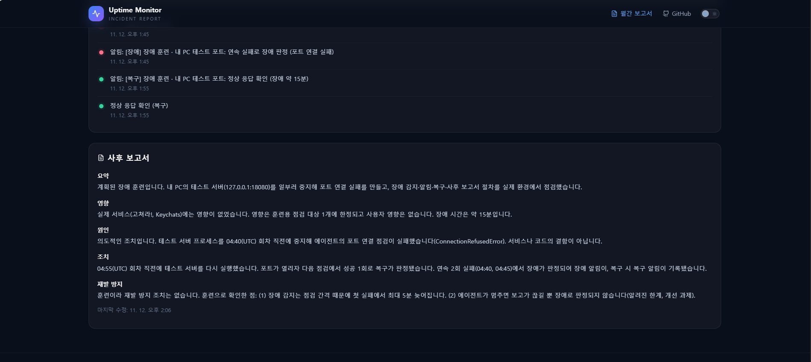 |

## 무엇을 하나

| 기능 | 내용 |
|---|---|
| 외부 점검 | Cloudflare Worker 예약 실행(Cron, 5분)으로 HTTP 상태 코드·응답 시간·키워드, DNS(DNS-over-HTTPS로 이름 풀림·기대값) 점검. 도메인 만료는 판정 로직만 ([한계](#알려진-한계와-다음-과제) 참고) |
| 내부 점검 | Windows PC의 Python 에이전트가 ping·TCP 포트·SSL 만료·디스크·서비스 상태를 측정해 API로 보고 (바깥으로만 연결) |
| 장애 판정 | 2회 연속 실패 → 장애, 1회 성공 → 복구. 상태가 바뀔 때만 알림 기록 |
| 오래 가는 장애 메일 | 서비스의 장애 구간(묶인 점검 중 하나라도 장애)이 **첫 실패부터 15분**을 넘으면 메일 1통, 복구되면 1통. 서비스당 구간마다 1번(점검 3개가 함께 죽어도 1통), 반복 알림 없음, 발송이 실패하면 다음 회차에 다시 시도. 짧은 장애는 화면 기록만 ([설정](#장애-메일-설정)) |
| 장애 이력·보고서 | 장애 1건마다 첫 실패·판정·복구 시각, 감지 시간(MTTD)·복구 시간(MTTR), 사후 보고서 5항목 |
| 계획 작업 | 미리 등록한 작업 시간의 점검은 장애로 보지 않고 가동률에서 제외 |
| 대시보드 (`/`) | 왼쪽 메뉴(대시보드·서비스·장애 이력·월간 보고서, 아래에 운영 근거). 요약 3칸(전체 서비스·정상·부분 장애/장애), **서비스 줄**(서비스 상태·30일 가동률·최근 점검·세부 점검 칩 — 칩을 누르면 그 점검의 상세 팝업), 최근 알림(안에서 스크롤), 운영 지표 요약(**숫자 타일 4개(2×2)** — 1440×900 화면에서 스크롤 없이 한눈에: HTTP·DNS 평균 응답은 숫자 + **전주 대비**(어제까지 7일 vs 그 전 7일, 두 주 모두 기록이 3일 이상인 서비스만, 일부만 비교했으면 'N/M개 기준', +30% 이상이면서 +100ms 이상 느려지면 노란 글씨 — 주간 보고서와 같은 기준) + 가장 느린 서비스 + 서비스 평균 작은 선, 가동률은 **100% 아래로 내려간 서비스 수**와 이름 하나 + 내려간 서비스만 작은 선, 장애는 30일 건수 + 최근 7일 — 타일을 누르면 팝업에서 **겹쳐 보기(범례 버튼으로 켜고 끔) · 순위(전체, 느린 순 막대) · 서비스별 미니 그래프**. 서비스마다 고유색 10개를 정해 서비스 줄 아이콘·막대·그래프에서 같은 색, 10개를 넘으면 점선), 그 아래 **오늘 확인할 것**(장애 중 > 점검 기록 15분 넘게 끊김 > 응답 느림 > 오늘 단발 실패(장애 판정 전) > 계획 작업 중, 점검마다 한 줄, 누르면 서비스 상세 — 없으면 "확인할 것 없음")과 **최근 변경**(첫 화면 변경 최근 7일, 줄마다 **배포**(빌드 파일 이름이 바뀜) · **내용 변경**(파일은 그대로) · **첫 화면 변경**(구별할 근거 없음) 표시, 변경 뒤 60분 안 같은 서비스 장애는 "직후 장애"로 장애 상세에 연결, 24시간 6번 이상 바뀐 서비스는 한 줄로 묶어 모두 배포면 "배포 잦음 · 24시간 N번", 아니면 "잦은 변경 · 24시간 N번"). 넓은 화면에서는 오른쪽 칸(운영 지표·확인할 것·최근 배포)이 스크롤해도 위에 붙어 따라옴(창이 낮으면 칸 안에서 스크롤), "다음 점검 MM:SS"(점검은 5분마다, 화면은 **점검 회차 직후에만** 새로 불러오고 다른 탭을 보는 동안은 쉼 — 실시간 감시가 아님) |
| 서비스 추가 | 대시보드 **[+ 서비스 추가]**: 링크를 넣으면 [미리 점검]으로 한 번 접속해 본 뒤 서비스와 점검(HTTP·DNS·선택한 상태 확인)을 만듦. 관리자 토큰 + 운영자 동의 확인 필수, 공개 https 도메인만, 켜진 서비스 10개까지 ([사용법](#서비스-추가--끄기)) |
| 서비스 묶음 | 점검 여러 개를 서비스 하나로 묶음(0015). 서비스 상태: 모두 정상 → 정상, 일부 장애 → **부분 장애**, 모두 장애 → 장애, 실패 없이 느림 → 주의. 서비스 가동률은 **묶인 점검이 모두 성공한 5분 회차의 비율**(같은 5분에 여러 점검이 함께 실패해도 장애 한 번) |
| 서비스 상세 (`/service.html?key=…`) | 대시보드의 서비스 줄을 누르면 열림. 서비스 가동률(30일·24시간), 첫 화면 평균 응답, 장애 수, 점검마다 24시간 응답 시간 선·15분 칸 성공/실패·30일 일별 막대, 최근 이벤트(사후 보고서 링크), 사이트 열기 링크 |
| 첫 화면 변경 감지 (17단계) | 서비스 대표 주소의 HTTP 점검이 이미 받은 본문으로 **지문(SHA-256)**을 만들어, 같은 새 지문을 **2회 연속** 보면 "내용 바뀜"으로 기록(요청은 늘지 않음, 본문은 저장하지 않음). 서비스 상세 '최근 이벤트'에 장애와 시간순으로 함께, 장애 상세 타임라인에 **장애 직전 60분 안의 변경**을 단서로 표시. 배포라고 단정하지 않음 |
| 점검 기록 분석 (서비스 상세 안, 16단계) | 7일/30일 중 골라서: **실패 이유 분포**(시간 초과·상태 코드·DNS 오류… 이유별 횟수·비율과 어느 점검에서 났는지), **p95 응답 시간**(점검마다 최근 24시간 p95·평균, 일별 p95 선), **시간대 열지도**(요일 × 시간(KST) 칸마다 실패·느림 비율). 모든 서비스·점검에 적용(우리 점검 기록에서 계산 — 서비스 쪽 DB와는 무관) |
| 주간 점검 보고서 (`/weekly.html?key=…&week=월요일 날짜`, 20단계) | 서비스 소유자에게 전달할 **한 주(월~일, 한국 시간) 요약**: 한 줄 판정(이상 없음 / 주의 / 장애 있었음 / 기록 없음), 가동률(전주 대비), 장애(영향 시간은 겹침을 한 번만 셈), 점검별 응답 시간(전주 대비·가장 느린 날 p95), 배포 추정(첫 화면 변경). **복사용 텍스트**와 인쇄/PDF 저장 제공. 새 테이블 없이 일별 집계에서 볼 때마다 계산하고, 소유자 연락처·점검 주소는 들어 있지 않음. 전달은 직접(자동 메일은 도메인 구매 뒤) |
| 서비스 페이지 (`/services.html`) | 점검별 카드(30일 가동률·응답 시간·30일 막대·"N분 전 점검"), 카드를 누르면 상세 팝업(최근 24시간 그래프, 30일 가동률, 30일 일평균 응답) |
| 장애 이력 (`/incidents.html`) · 운영 근거 (`/evidence.html`) | 최근 장애와 사후 보고서 링크 / 장애 훈련 기록·판정 규칙 측정·자동 테스트·알려진 한계 |
| 화면의 최신 여부 확인 | 3분 넘게 새 데이터를 받지 못하면 "다음 점검" 옆 점이 노란색 '연결 지연'으로 바뀌고, 불러오기에 실패하면 마지막으로 받은 화면을 두고 안내만 띄움. (예전 상태 페이지의 '30분 넘게 점검 기록 없음' 요약 규칙은 새 대시보드에 없음 — `public/summary.js`는 지금 어느 화면도 쓰지 않음) |
| 월간 보고서 | 대상별 가동률·SLA(99.9%) 달성·에러 버짓·장애 지표, 인쇄/PDF 저장 |
| 화면 테마 | 어두운 화면(기본, 업무용)과 밝은 화면(보고·공유용)을 토글 스위치(대시보드는 왼쪽 메뉴 아래, 월간 보고서·장애 상세는 헤더)로 전환, 고른 값은 브라우저에 저장. 주소 끝 `?theme=light`로 열면 처음부터 밝은 화면 |

## 구성

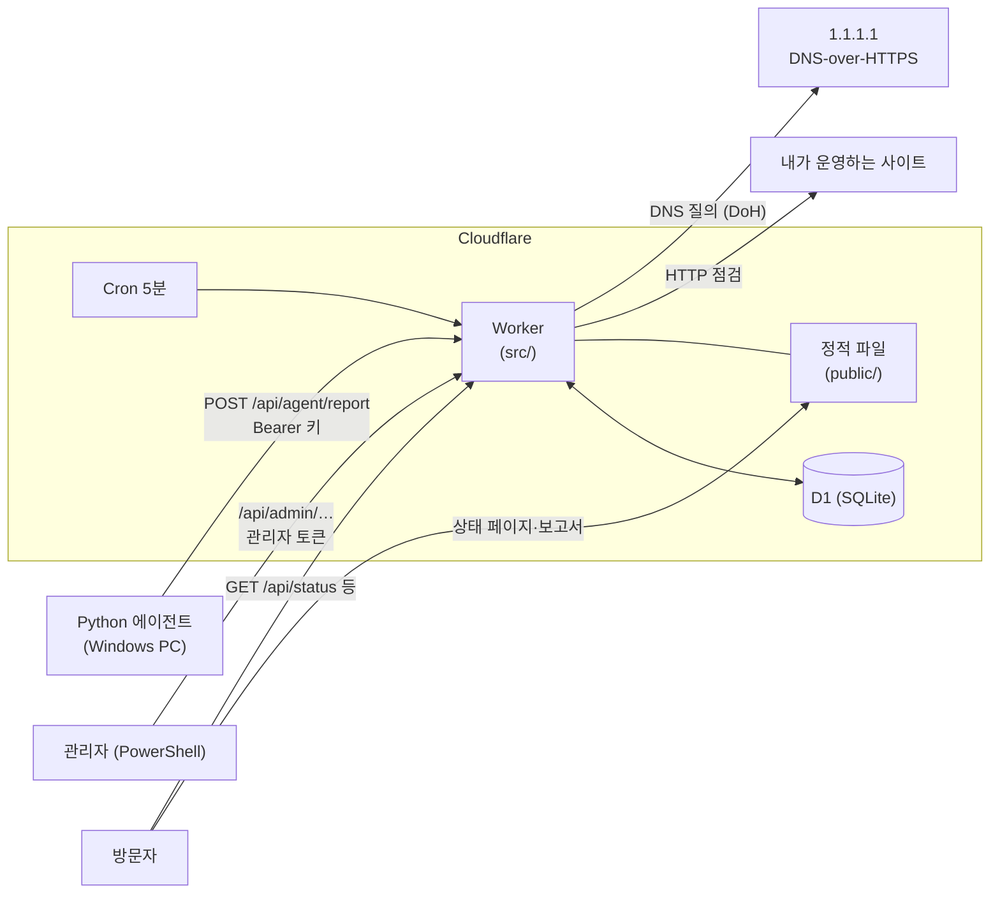

점검 1회의 흐름 (Cron 점검·에이전트 보고·에이전트 무응답 감지가 모두 같은 경로 `src/record.js`를 사용):

```
측정 → 판정(순수 함수) → 계획 작업 확인 → 상태 전이(장애/복구)
    → [결과 + 상태 + 장애 이력] 한 batch 저장 → 알림(log 채널) → 일별 집계(KST)
```

## 기술

- **Cloudflare Workers** (Cron + API + 정적 파일), **D1**(SQLite), **wrangler**
- 화면: 빌드 도구 없는 HTML/CSS/JS
- 판정·계산 로직은 순수 함수로 분리해 `node --test`로 테스트
- 에이전트: Python 3 표준 라이브러리만 사용
- 테스트: JS 455개·Python 22개 (외부 접속·원본 데이터 없이 CI에서도 돌아감, 2026-11-19 로컬 확인)

## 주요 설계 판단

| 판단 | 이유 |
|---|---|
| 장애는 **2회 연속 실패**, 복구는 **1회 성공** | 일시적 흔들림으로 인한 오탐·알림 피로를 줄이고, 복구는 빨리 알려 장애 시간이 부풀지 않게 (감지는 최대 5분 늦어짐) |
| 점검 시각을 **5분 회차로 내림**해 저장 | Cron이 정각보다 몇 초 늦게 실행됨(실측 :12초). 회차 단위로 묶어 집계·비교 |
| 저장은 **UTC**, 하루·한 달은 **KST** | 기준을 하나로 저장하고, 사람이 보는 경계는 한국 시간으로 (서머타임 없음) |
| 에이전트는 **측정만**, 판정은 **서버** | 기준값을 한곳에서 관리, 에이전트가 여러 대여도 판정 일관 |
| 에이전트는 **바깥으로만 연결(push)** | PC에 들어오는 포트를 열지 않음. 대신 에이전트가 멈추면 보고가 끊김(아래 한계 참고) |
| 결과·상태·장애 이력을 **한 batch**, 알림은 **저장 후** | 기록끼리 어긋나지 않게 하고, 알림 실패가 점검 기록을 막지 않게 |
| 모든 기록에 **출처(source)** + DB CHECK 제약 | 실제·가짜 데이터가 섞여 보이지 않게. 시뮬레이터 보고는 시뮬레이터 대상에만 기록 |
| 배포본에서 **가짜 데이터를 없앰** (2026-11-19) | 출처 배지로 구분해도 첫 화면의 서비스 대부분이 시연 데이터면 "실제로 무엇을 운영하나"가 흐려짐. 실제 서비스만 남기고, 가짜 데이터는 테스트 고정 자료로만 둠. 지우기 전 백업과 전후 건수 대조([scripts/purge-fake-data](scripts/purge-fake-data/README.md)) |
| 서비스 가동률은 **회차(5분) 단위**, 하루 1행으로 **미리 집계** (0015) | 점검별 가동률을 평균 내면 같은 5분 장애를 점검 수만큼 깎음. 30일 원본을 화면마다 읽으면 D1 읽기 한도를 금방 쓰므로 Cron이 대상 집계 때 읽은 원본을 재사용해 서비스 일별 집계(`service_daily_stats`)를 갱신. 지난 기록 채우기 SQL과 Cron 순수 함수가 같은 결과인지 테스트로 비교 |
| 분석 값(p95·시간대별·실패 이유)도 **Cron이 미리 계산**해 일별 집계 행에 JSON으로 저장 (0017) | 화면을 열 때 원본을 세면 서비스 하나(점검 3개) 30일이 약 2.6만 행. Cron은 이미 매 회차 오늘·어제 원본을 읽으므로 같은 원본으로 함께 계산하면 추가 읽기 0. 시간대별 값을 '시간당 1행' 표 대신 하루 1행의 24칸 JSON으로 둬서 점검당 30행만 읽음(정규화보다 읽기 비용 우선 — 조건 검색할 일이 없는 표시용 요약) |
| p95는 **nearest-rank**, 평균과 함께 표시 | 평균은 가끔 아주 느린 요청을 가림. 보간 없이 실제로 관측된 값만 써서 설명이 쉽고 어디서 계산해도 같은 값. 기간 p95는 일별 p95를 합쳐 만들 수 없어서(백분위수는 더하거나 평균 낼 수 없음) 화면은 **일별 p95 추이**와, 받은 24시간 원본으로 정확히 계산한 **24시간 p95**를 보여 줌 |
| 0017 이전 기록은 **Cron이 회차마다 6건씩 채움** | p95를 SQL로 구하려면 윈도 함수가 필요한데 D1 공식 문서에 지원 여부가 없음. 같은 규칙을 SQL과 JS 두 곳에 두면 어긋날 수 있어 순수 함수(`analyzeDay`) 하나로 계산. 한 회차의 읽기가 커지지 않게 조금씩, 다 채우면 빈 조회 1번만 남음 |
| 변경 감지는 **본문 해시 + 2회 연속 확인**, 이름은 '배포'가 아니라 **'변경'** (0018) | 고쳐라!(Cloudflare Pages)는 ETag가 없어 본문 해시를 씀(사전 조사: 두 서비스 모두 반복 요청에서 해시가 같음). 장애 판정과 같은 2회 연속 규칙으로 잠깐 섞인 응답을 무시하고, 실패 응답(오류 페이지)은 장애이지 변경이 아니라서 뺌. 보이는 것은 "응답이 달라졌다"뿐이라 원인(배포·CDN·동적 내용)은 단정하지 않고, 하루 6번 넘게 바뀌면 "자주 바뀜" 안내. 같은 지문이 계속되면 DB 쓰기 없음 |
| 서비스별 수신자는 **틀만 만들고 꺼 둠**, 확인은 **두 단계(링크 → 버튼)**, 링크 토큰은 **저장하지 않음** (0019) | 아직 주소를 받을 수 없는데(도메인·지침) 나중에 바로 켤 수 있게. 메일 보안 검사기가 링크를 미리 열어도 등록·해지되지 않게 GET은 버튼만 보여 주고 POST로 처리. 토큰은 비밀 값으로 계산하는 HMAC(용도·id·주소·추가 시각)이라 DB가 새어도 링크를 만들 수 없음. 운영자에게 보낸 문구를 구간에 저장해, 실패한 수신자에게 다음 회차에 같은 문구로 다시 보냄 |
| 가동률은 **내림** 표시, 기간 가동률은 **점검 수 합계**로 | 99.99…%가 100%로 보이지 않게, 날짜별 % 평균의 왜곡 방지 |
| 계획 작업 중 점검은 **기록하되 가동률·판정에서 제외** | SLA의 일반 규칙. 남용 방지를 위해 최대 24시간·소급 등록 금지 |
| 에이전트 키와 관리자 토큰 **분리**, 타이밍 안전 비교 | 최소 권한, 키 추측 공격 방지 |

## 실제 데이터와 가짜 데이터

배포본(원격 D1과 공개 화면)에는 **실제 점검 기록만** 있습니다. 모든 기록에는 출처(`source`)가 남고, 실제가 아닌 기록이 들어오면 화면이 '시뮬레이터'·'실제 아님' 배지로 따로 표시합니다.

| 구분 | 무엇 | 어디에 |
|---|---|---|
| **실제** (`real`) | **고쳐라! 웹게임**(`gochyeora.pages.dev`, 내가 운영하는 사이트)의 HTTP·DNS 점검. Worker Cron이 **5분마다 실제 점검** (2026-11-11부터) | 배포 DB·화면 |
| **실제** (`real`) | **사내 메신저**(= [Keychats](https://github.com/Nalzzo-ALEPH26/SKT_ALEPH_KEYCHATS), 학원에서 쓰려고 팀이 만든 채팅 사이트)의 점검 3종: HTTP(첫 화면), DNS, DB 상태(`/chats/api/health`). **5분마다 실제 점검** (2026-11-12부터). 상태 확인 주소는 Keychats 쪽에서 DB를 1번 조회해 `ok`/`error`만 돌려주며 사용자·채널·메시지는 건드리지 않음 | 배포 DB·화면 |
| 가짜 (테스트 전용) | `test/fixtures/sample.sql`(가상 서비스·장애·보고서), `test/fixtures/simulator-monitors.sql`(가상 내부 장비 4개). 출처는 각각 `sample`·`simulator` | 테스트의 가짜 D1(Node 내장 SQLite)에만. **배포 DB에 넣지 않음** |
| 가짜 (로컬 시험) | 에이전트 시뮬레이터(`agent/agent.py --simulate`)의 시나리오 측정값. 출처 `simulator` | 로컬 D1에 시뮬레이터 대상을 넣었을 때만. 배포 DB에는 시뮬레이터 대상이 없어 수신 API가 거절함 |

- **"실제 점검" 배지는 기록의 출처가 실제 점검이라는 뜻이지 "지금 점검 중"이라는 뜻이 아닙니다.** 점검을 꺼 둔 실제 대상은 카드에 "점검 대기"로 보이고, 상단 요약의 분모에서 빠집니다.
- 판정 규칙 성능 측정에는 공개 데이터셋(SMD·NAB)을 썼지만, **오프라인 계산일 뿐 DB와 화면에는 들어가지 않습니다**([판정 규칙 성능 측정](#판정-규칙-성능-측정)).

### 가짜 데이터 정리 (2026-11-19)

처음에는 실제 서비스가 적어서 공개 데이터셋 재생(`replay`, 다른 조직의 과거 운영 기록)·에이전트 시뮬레이터(`simulator`)·데모(`sample`)를 출처 배지와 함께 섞어 보여 줬습니다. 출처를 표시해도 첫 화면의 서비스 대부분이 시연 데이터라 "실제로 무엇을 운영하나"가 흐려져서, **실제 운영 서비스만 남기기로** 했습니다.

| 지운 것 | 남긴 것 |
|---|---|
| 재생 대상 5개·시뮬레이터 대상 4개와 그 측정·집계·알림·장애·상태 기록, 재생 시계열·설정·데이터셋 메타 | 고쳐라!·Keychats 모니터 5개와 그 기록 전부 |
| 장애 훈련 대상과 훈련 장애 #41·계획 작업 기록 (출처는 `real`이지만 실제 서비스가 아님) | 훈련 기록은 [PDF](#장애-훈련-기록)로 보존 |
| 재생 실행 코드(Cron), 화면의 재생·데모 표시와 출처 필터, `seed/`, `scripts/prepare-datasets/` | 판정 순수 함수 `src/replay.js`(성능 측정이 사용), 테스트 고정 자료 |

- 순서: **백업**(`wrangler d1 export`) → 지우기 전 건수 조회 → 삭제 → 같은 조회로 대조. 삭제한 행 수(19,144)가 미리 계산한 값과 같았습니다. 절차와 결과는 [scripts/purge-fake-data/README.md](scripts/purge-fake-data/README.md).
- 데이터를 코드보다 먼저 지웠습니다. 재생 코드는 설정이 비면 아무것도 하지 않고, 수신 API는 등록되지 않은 대상의 보고를 거절해서, 코드 정리 전에도 안전했습니다.
- 마이그레이션 0008~0010(재생 출처·표)은 이미 적용된 이력이라 파일을 지우지 않았고, 빈 재생 표도 아직 남아 있습니다.

## 장애 훈련 기록

실제 서비스(고쳐라!, Keychats)를 건드리지 않고 "장애 감지 → 알림 → 복구 → 사후 보고서"와 계획 작업 처리를 실제 환경에서 확인한 훈련입니다. 2026-11-12에 했습니다.

> 2026-11-19 가짜 데이터 정리 때 훈련 대상과 장애 #41·계획 작업 기록을 DB와 화면에서 지웠습니다. 아래 기록과 [PDF](docs/drills/drill-a-incident-41.pdf)·스크린샷만 남아 있습니다.

**방법:** 내 PC에서 테스트 서버(`python -m http.server 18080 --bind 127.0.0.1`, 내 PC에서만 열림)를 켜 두고, Python 에이전트(**실제 모드**, 설정은 저장소 밖 임시 파일)가 그 포트의 연결 여부를 5분마다 보고합니다. 서버를 끄고 켜는 것으로 장애를 만들었습니다. 점검 대상 `장애 훈련 · 내 PC 테스트 포트`는 마이그레이션 0012로 등록했고, 이름에 '훈련'을 넣었으며, 훈련이 끝난 뒤 비활성(점검 대기)으로 돌렸습니다.

### 훈련 A: 장애 → 알림 → 복구 → 사후 보고서 (장애 #41)

| 시각 (한국 / UTC) | 일어난 일 |
|---|---|
| 13:30 ~ 13:35 / 04:30 ~ 04:35 | 정상 2회 |
| 13:36 ~ 13:41 사이 | 테스트 서버 중지 (정상 2회를 확인한 직후) |
| 13:40 / 04:40 | 첫 실패 (`ConnectionRefusedError`), 장애 시작 시각으로 기록 |
| 13:45 / 04:45 | 두 번째 연속 실패 → **장애 판정**, 알림 기록 ("포트 연결 실패") |
| 13:51 ~ 13:56 사이 | 테스트 서버 재실행 (13:50 회차까지는 실패) |
| 13:55 / 04:55 | 재실행 후 첫 점검 성공 1회 → **복구 판정**, 복구 알림 기록 |

| 지표 | 값 |
|---|---|
| 장애 지속 시간 | 15분 (첫 실패부터 복구까지) |
| 감지까지 걸린 시간 | 5분 (연속 2회 규칙: 첫 실패에서 판정까지) |
| 출처 | `real` (에이전트 실제 모드) |

장애 상세와 사후 보고서 5항목(요약·영향·원인·조치·재발 방지)은 관리자 API로 작성했습니다. 보고서에는 계획된 훈련이라고 적었습니다.
- PDF: [장애 #41 상세·사후 보고서](docs/drills/drill-a-incident-41.pdf), [2026년 11월 월간 보고서](docs/drills/drill-monthly-report-2026-11.pdf)
- 화면: [타임라인](docs/screenshots/incident-41-timeline.png), [사후 보고서](docs/screenshots/incident-41-report.png)

### 훈련 B: 계획 작업 중에는 장애로 보지 않음

14:15 ~ 14:35(한국 시간, 20분)을 계획 작업으로 등록하고, 그 시간에 테스트 서버를 다시 껐습니다.

| 시각 (한국) | 결과 |
|---|---|
| 14:11 | 정상 (작업 시작 전) |
| 14:15 | 대상 상태가 **계획 작업 중(`maintenance`)**으로 바뀜 |
| 14:16, 14:21, 14:26, 14:31 | 점검 실패 4번, 모두 "작업 중"으로 기록, **장애·알림 없음** |
| 14:35 | 작업 종료, 상태 `up`으로 복귀 |
| 14:36 | 작업 시간 밖의 정상 점검으로 기록 |

월간 보고서에서 작업 중 4번의 실패는 **점검 수와 가동률 계산에서 제외**되었고, 계획 작업 시간은 20분으로 집계되었습니다.

### 훈련에서 확인한 것과 한계

- 감지는 점검 간격(5분)과 연속 2회 규칙 때문에 첫 실패에서 최대 5분 늦어집니다. 복구는 성공 1회로 바로 판정됩니다.
- 훈련 당시에는 에이전트가 멈추면 장애로 판정되지 않고 보고가 끊길 뿐이었습니다. 훈련 B 이후 에이전트를 끄자 점검 기록이 더 이상 쌓이지 않은 것으로 확인했고, 이 한계는 이후 [무응답 감지](#에이전트-무응답-감지)(0013)로 보완했습니다(대상마다 켜야 함).
- 이 장애는 **내가 일부러 낸 것**이라 서비스 품질의 증거가 아니라 **기능이 의도대로 동작한다는 증거**입니다. 훈련 대상의 가동률이 낮게 나오는 것은 그래서입니다.
- 에이전트는 내 PC의 `127.0.0.1` 훈련 포트 하나만 보고했고, 실제 모드의 다른 점검(디스크·서비스·ping 등)은 이번에 쓰지 않았습니다.

## 판정 규칙 성능 측정

"연속 2회 실패면 장애"라는 규칙이 실제로 얼마나 잘 맞는지, 라벨(정답)이 있는 공개 데이터로 재 봤습니다. 표 전체는 [docs/evaluation/results.md](docs/evaluation/results.md)에 있고, 이 절은 읽는 법과 결론입니다.

### 사용한 공개 데이터셋

| 데이터셋 | 라이선스·조건 (원본에서 직접 확인) |
|---|---|
| [SMD](https://github.com/NetManAIOps/OmniAnomaly) (Server Machine Dataset) | MIT (`ServerMachineDataset/LICENSE`, 2026-11-12 확인). 값은 0~1 정규화 상대값이고 지표 이름은 공개되지 않음 |
| [NAB](https://github.com/numenta/NAB) (Numenta Anomaly Benchmark) | MIT 형식 (`LICENSE.txt`, 2026-11-12 확인) |

원본(수십 MB)은 저장소에 올리지 않고 저장소 밖 폴더에 받아 씁니다.
인용: NAB — Ahmad, Lavin, Purdy, Agha, *Unsupervised real-time anomaly detection for streaming data*, Neurocomputing 2017 (arXiv:1510.03336). SMD의 논문 인용은 저장소 README에서 찾지 못해 비워 두었습니다.

### 어떻게 쟀나

- **운영 판정 함수 그대로:** 값 하나를 정상·실패로 가르는 `judgeReplay`는 운영 코드를 import해서 썼습니다. 연속 N회 규칙은 운영 `state.js`의 상수(2)를 바꾸지 않으려고 같은 규칙을 측정 스크립트에 따로 두었고, **N=2일 때 운영 상태 머신과 똑같이 움직이는지 무작위 흐름 50개로 비교하는 테스트**를 넣었습니다.
- **선택 편향 피하기:** 당시 상태 페이지 재생에 쓴 서버·파일(SMD 1-1, 2-1, 3-1, NAB machine_temperature)은 지표와 기준값을 정할 때 이미 본 데이터라서 공식 결과에서 뺐습니다. 공식 결과는 **다른 서버 3대(SMD 1-2, 2-2, 3-2)와 다른 NAB 파일 3개**에서만 냈습니다. SMD는 지표를 라벨 보고 고르지 않고 38개를 **전부** 평가해 합쳤습니다.
- **시간 순서 분할:** 시계열마다 앞 30%로 임계값(값의 99% 지점)을 정하고(라벨 안 씀), 뒤 70%에서만 점수를 냈습니다.
- **지표:** 탐지율(이상 구간 중 알림이 울린 비율), 오탐(어떤 이상 구간과도 안 맞는 알림), 지연(이상 구간 시작 → 첫 알림). 알림이 이상 구간의 앞뒤 15분 안에 있으면 맞은 것으로 봤습니다.

### 결과 (SMD 서버 지표, 시계열 83개 · 이상 구간 123건, 값 상위 99% 기준)

| 연속 실패 | 탐지율 | 오탐/시계열·일 | 알림 정밀도 | 지연(중앙 / 90%) |
|---|---|---|---|---|
| 1회 | 85.4% (105/123) | 3.80 | 20.3% | 0분 / 55분 |
| **2회 (운영)** | **44.7% (55/123)** | **0.81** | 19.8% | 5분 / 60분 |
| 3회 | 26.8% (33/123) | 0.27 | 24.9% | 10분 / 20분 |

- 1회 → 2회: 오탐이 약 79% 줄고(3.80 → 0.81), 탐지율은 40.7%p 떨어집니다. 지연 중앙값은 0분에서 5분이 됩니다.
- 2회 → 3회: 오탐은 67% 더 줄지만 탐지율이 17.9%p 더 떨어지고 지연 중앙값이 5분 더 늘어납니다.
- **정밀도는 연속 횟수를 바꿔도 20~25%에 머뭅니다.** 오탐이 "한 칸짜리 튀는 값"이 아니라 몇 칸씩 이어지는 값이라 연속 횟수로는 걸러지지 않는다는 뜻입니다.
- 임계값을 95% → 99.9%로 올려도 연속 2회에서 오탐은 2.12 → 0.85로 줄다 99%부터 거의 멈춥니다(0.81~0.85). 평가 구간에서 평소 수준이 앞 30%와 달라진 시계열이 있어서일 가능성이 있지만, 이번에 원인을 확인하지는 않았습니다.
- **라벨을 보고 서버마다 지표를 골랐다면** 같은 규칙으로 탐지율 83.3%(5/6, 이벤트가 6건뿐)에 오탐 0.06으로 나옵니다. 전체 평균(44.7%, 0.81)과 비교하면 **지표 선택만으로 점수가 이렇게 부풀 수 있습니다.** 당시 상태 페이지의 재생 카드(지금은 삭제)가 이렇게 고른 지표였습니다.
- NAB(검증 파일 3개, 이상 창 6개)는 표본이 너무 작아 규칙 우열을 말할 수 없습니다. ±10%(연속 2회)는 6개를 다 잡지만 시계열당 하루 오탐이 3.6건이고, `cpu_utilization` 파일 하나가 연속 2회·±20%에서 오탐 899건을 냈습니다(원인은 확인하지 않음).

### 이 결과로 말할 수 있는 것과 없는 것

- **말할 수 있는 것:** 잡음이 많은 연속 값(서버 지표)에서 연속 횟수를 늘리면 오탐은 크게 줄고 탐지율과 지연이 나빠지는 교환 관계가 있고, 운영의 2회는 그 중간입니다.
- **말할 수 없는 것:** 이 서비스의 HTTP 점검이 실제 장애를 몇 % 잡는지. 공개 라벨 데이터는 서버 지표·센서 값이지 "응답 없음"이 아니어서, HTTP처럼 성공·실패가 뚜렷한 점검에서는 연속 2회의 효과가 훨씬 깔끔할 것으로 예상하지만 **이번 데이터로 검증하지 못했습니다.**

### 한계

- **구간 단위 평가:** 이상 구간 안에서 한 번만 맞춰도 탐지로 칩니다. 지연을 함께 보고하는 이유입니다.
- **표본이 독립적이지 않음:** 한 서버의 여러 지표는 같은 이상 구간을 공유하므로 123건은 서로 독립인 123건이 아닙니다. 독립적인 표본 수는 이보다 훨씬 적습니다(얼마나 적은지는 계산하지 않았습니다).
- **지표별 정답은 해석 라벨에서:** SMD의 `interpretation_label`을 이용해 지표마다 잡아야 할 구간을 정했는데, 지표 번호가 1부터인지는 원본 설명으로 확인하지 못해 1부터라고 **가정**했습니다. 틀렸다면 지표별 이벤트 배정이 어긋납니다(전체 이상 구간 기준의 오탐 판정은 영향이 없습니다).
- **라벨이 완전하지 않을 수 있음:** 라벨에 없는 진짜 이상은 오탐으로 셉니다.
- **기준값에 이상 구간이 섞일 수 있음:** 앞 30%에도 이상이 있을 수 있고, 운영도 같은 방식이라 그대로 두었습니다. 값이 거의 상수인 시계열 31개(114개 중)는 규칙을 만들 수 없어 모든 규칙에서 뺐습니다.
- **NAB `ambient_temperature`는 점검 간격이 60분**이라 "연속 2회"가 2시간입니다. 지연·일수는 분 단위로 맞췄습니다.
- 허용 15분, 앞 30%, 99% 지점은 정한 값이지 최적화한 값이 아닙니다.

### 다시 돌리려면 (Windows PowerShell)

```powershell
node scripts/evaluate-rules/fetch-heldout.mjs      # 평가용 원본 (서버 3대 + NAB 4개 + NAB 라벨, 저장소 밖 폴더, 이미 있으면 건너뜀)
node scripts/evaluate-rules/run.mjs                # docs/evaluation/results.md·results.json 갱신
```

2026-11-19 재생용 데이터 준비 스크립트를 지운 뒤 다시 실행해, 결과 파일이 이전과 똑같이 나오는 것을 확인했습니다.

## 에이전트 무응답 감지

에이전트는 바깥으로만 연결하므로, 에이전트(또는 PC·네트워크)가 멈추면 서버에는 아무 일도 없는 것처럼 보입니다. 마지막 보고가 오래됐으면 이를 실패 점검(`agent_silent`, 화면 문구 "에이전트 보고 없음")으로 기록합니다.

- **켜는 방식:** `monitors.stale_after_min`(분)이 있는 대상만 감시합니다. 기본은 NULL(꺼짐)이라 0013을 적용해도 화면과 판정이 바뀌지 않습니다. 수동으로 보낼 때만 갱신되는 대상(예: 시뮬레이터)에 일괄로 켜면 가짜 무응답 장애가 계속 생기기 때문입니다.
- **판정:** 마지막 *실제 보고* 회차로부터 지난 분이 기준을 **넘으면** 무응답입니다. 기준 15분이면 마지막 보고 뒤 20분 회차에 첫 실패, 연속 2회 규칙으로 25분 회차에 장애 판정입니다(딱 15분은 한 회차 여유). 보고가 다시 오면 기존 규칙(성공 1회)으로 복구됩니다.
- **같은 경로 재사용:** 새 판정 경로를 만들지 않고 `record.js`에 실패 점검을 넘깁니다. 알림·장애 이력·계획 작업 제외·일별 집계가 그대로 적용됩니다.
- **한 번도 보고한 적 없는 대상은 판정하지 않습니다.** 새로 등록하자마자 장애로 뜨는 것을 막기 위해서입니다.

한계: (1) 에이전트가 멈춘 것인지 PC가 꺼진 것인지 서버는 구분할 수 없습니다. (2) 무응답 구간은 실패 점검으로 쌓여 가동률이 내려갑니다("확인하지 못한 시간"을 장애로 보는 보수적 선택). (3) 무응답이 기록된 회차에 같은 회차의 보고가 늦게 오면 그 보고는 중복 방지 규칙으로 건너뛰고, 다음 회차 보고부터 받습니다(복구가 최대 5분 늦어질 수 있음, 테스트로 확인). (4) 지금은 켠 대상이 없고, 원격 환경에서 켜 보는 검증은 하지 않았습니다(배포와 로그 확인까지만 함).

켜는 예시(마이그레이션 0013을 적용한 뒤, 대상의 `check_key`는 직접 정합니다):

```powershell
npx.cmd wrangler d1 execute status-monitor-db --remote --command "UPDATE monitors SET stale_after_min = 15 WHERE check_key = '<대상 키>'"
```

## 데이터 보존 정책

5분마다 점검하면 원본(`check_results`)이 **하루 약 6,000행**(켜진 점검 21개 × 288회) 쌓입니다. 2026-11-25에 원격 D1을 읽기만 해서 확인한 값은 14일 동안 33,622행, DB 3.66MB였고, 그대로 두면 원본만 1년에 약 220만 행·약 240MB가 됩니다(행당 크기를 거꾸로 계산한 추정). 그래서 **가장 자세한 원본만 오래된 것부터 지우고, 요약은 계속 남깁니다** (25단계).

| 데이터 | 보존 | 쓰는 곳 |
|---|---|---|
| 5분 점검 원본 | **오늘 포함 90일** — 그 전 날은 매일 KST 04:00 회차에 삭제 | 상세 그래프(최근 48시간), 일별 집계 계산(어제·오늘), RCA(최근 1시간) |
| 일별 집계(점검·서비스) | 계속 (하루 약 30행) | 가동률, 30일 막대, 운영 지표, 월간·주간 보고서 |
| 장애·사후 보고서·알림·첫 화면 변경 | 계속 (수가 적음) | 장애 이력, 최근 알림, 최근 배포(추정) |

- **왜 90일:** 화면이 원본을 쓰는 기간(최대 48시간) + 장애를 한 분기 안에서 다시 들여다볼 여유. 90일이면 원본이 약 54만 행(약 60MB 추정)에서 더 늘지 않습니다. 공공기관처럼 로그 보존 기간이 규정으로 정해진 곳과는 기준이 다릅니다.
- **지우는 순서와 안전장치:** 점검마다 기준(남기는 첫 날의 KST 0시)보다 오래된 원본을 **오래된 것부터** 지웁니다. 그날 **일별 집계가 있는 원본만** 지우고(집계가 없는 날의 원본은 그날 가동률의 유일한 근거라 남김), 한 번에 **10,000행까지만** 지웁니다(남은 것은 다음 날). 정리할 때마다 `retention_runs`에 시각·기준일·지운 행·남긴 행을 1행 남기고, 운영 근거 화면(`/evidence.html`)에 마지막 결과를 보여 줍니다.
- **D1 한도와 비용 (Cloudflare 공식 문서, 2026-10~11 수정본 기준, 이 프로젝트는 무료 플랜):** 무료 플랜은 DB 1개 500MB, 하루 읽기 500만 행·쓰기 10만 행이고, 넘으면 그날(UTC 0시까지) 쿼리가 실패합니다. DELETE도 '쓰기'로 세고 색인 행만큼 더 셉니다. 그래서 날짜만으로 지우지 않고 점검 id + 시각으로 지워 기존 색인 `(monitor_id, checked_at)`을 타게 했습니다(표 전체를 훑으면 훑은 행을 모두 '읽기'로 셈). 평소 하루 삭제는 약 6,000행(색인 포함 쓰기 약 1.2만 행 추정).
- **되돌리기:** 지운 원본은 되돌릴 수 없습니다. D1 Time Travel(무료 7일·유료 30일)로 DB를 과거 시점으로 되돌릴 수는 있지만 **DB 전체를 덮어써서** 그 뒤의 점검 기록도 함께 사라집니다. 무료 플랜은 7일뿐이라, 첫 실제 삭제 전과 그 뒤 한 달에 한 번 `npx wrangler d1 export status-monitor-db --remote --output=backup-YYYYMMDD.sql`로 백업 파일을 받아 둡니다(운영 기록이 들어 있어 저장소에는 올리지 않음, `.gitignore`의 `backup-*.sql`).
- **처음 실제로 지워지는 날:** 실제 점검이 2026-11-11부터라 약 2027-02-09(KST 04:00)입니다. 그 전까지는 매일 "지울 것 0행"으로 기록만 남습니다.
- **읽기량은 보존 정책과 따로 줄였습니다** (아래 [D1 읽기 예산](#d1-읽기-예산)).

### D1 읽기 예산

무료 플랜은 하루 읽기 500만 행이고, 넘으면 그날(KST 09:00까지) 점검 기록과 화면 API가 모두 실패합니다. 2026-11-25에 `wrangler d1 insights`(24시간, 조회별 읽은 행)로 재 보니 하루 약 **355만 행(71%)**이었고, 원인은 저장된 양이 아니라 **조회 방식**이었습니다 (26단계).

| 조회 | 24시간 읽기 (실측) | 원인 | 바꾼 것 |
|---|---|---|---|
| 일별 집계용 원본 읽기 (Cron) | 231만 | 매 회차 점검 21개 × **어제 + 오늘** 원본을 다시 읽음 | 어제는 KST 00:00~00:25·01:00 회차에만 (자정이 지나면 어제 원본은 안 바뀜) |
| 일별 집계 `WHERE day >= ?` (API) | 47만 | 기본 키 (monitor_id, day)를 못 써서 **표 전체를 훑음** — 집계는 계속 보관하므로 날이 갈수록 늘어남 | id 목록(하위 조회) + 날짜로 기본 키를 타게 (읽는 행 = 돌려주는 행) |
| 서비스 일별 집계 `WHERE day >= ?` (API) | 10만 | 같은 원인 | 같은 방식 |
| 최근 배포 목록 (24단계에서 생긴 조회) | 배포 뒤 69회에 4.6만 (호출당 661행, 하루로 환산 약 110만) | 행마다 하위 조회 | 7일치를 색인으로 한 번 읽고(약 40행) 서비스당 3건·횟수는 서버 코드에서 계산 |
| 분석 값 채우기 확인 (Cron) | 2.9만 | 이미 끝난 작업이 매 회차 표 전체를 훑음 | Cron에서 부르지 않음 (남은 날 0) |
| 대시보드 새로고침 | 하루 약 1,700회 호출 | 열어 둔 화면이 60초마다 부름 (데이터는 5분마다만 바뀜) | 점검 회차 직후에만, 숨은 탭은 쉬고 다시 보이면 1번 |

- 결과가 같은지는 기존 테스트(최근 배포 응답 포함)와 실행 계획(`EXPLAIN QUERY PLAN`) 테스트로 확인했고, 실제 읽기량은 배포 다음 날 같은 방법으로 다시 재서 이 표에 적습니다. 예상은 하루 100만~150만 행(20~30%)입니다(추정).
- 남은 것: 서비스·서비스 상세·장애 이력 화면은 아직 60초마다 다시 부릅니다(대시보드보다 덜 열어 두는 화면이라 이번에는 대시보드만 바꿈). 방문자가 많아지면 API 읽기는 방문자 수에 비례해 늘어나므로, 그때 Worker 응답 캐시(Cache API — `workers.dev` 주소에서 동작하는지는 공식 문서에 없어 직접 실험 필요, 데이터센터마다 따로)를 검토합니다.
- 자정 직후 30분과 01:00 회차가 모두 실패하면 어제 마지막 몇 회차가 어제 집계에 빠질 수 있습니다(드묾).

## 폴더 구조

```
src/            Worker 코드
  index.js        진입점 (Cron, HTTP 경로)
  checker.js      HTTP 측정        judge.js       HTTP·DNS·도메인 만료 판정
  dns.js          DNS 측정 (DNS-over-HTTPS)
  agent-judge.js  에이전트 보고 검증·판정
  state.js        장애 판정(상태 전이)   record.js  기록 공용 경로
  notify.js       알림 발송         channels/log.js  log 채널 (D1 기록)
  aggregate.js    일별 집계·가동률   report.js  월간 보고서 계산
  incident.js     장애·계획 작업 계산  time.js   회차 시각
  ingest.js       에이전트 보고 API  admin.js  관리자 API
  api.js          공개 조회 API     auth.js   토큰 확인   db.js  SQL 모음
  replay.js       값 판정 순수 함수 (재생 기능은 삭제, 판정 규칙 성능 측정이 사용)
  stale.js        에이전트 무응답 판정(순수 함수)   stale-run.js  Cron 무응답 실행 → record.js
  service-status.js  서비스 상태 판정·회차 단위 가동률 (순수 함수, 0015)
  service-admin.js   서비스 추가 입력 검사·서비스 키·점검 목록 (순수 함수, S4)
  escalation.js      오래 가는 장애 메일 판단·문구 (순수 함수)   escalation-run.js  Cron 메일 실행   channels/email.js  메일 채널
  weekly-report.js   주간 점검 보고서: 주 범위·요약·판정·복사용 텍스트 (순수 함수, 20단계)
public/         대시보드(index·app·dashboard-model·dashboard.css), 서비스 상세(service·service-detail), 서비스 점검 카드(services), 장애 이력(incidents), 운영 근거(evidence),
                점검 상세 팝업(detail.js), 장애 상세, 월간 보고서 (HTML/CSS/JS)
migrations/     D1 스키마 (0001 ~ 0016; 0008~0010 재생 출처·설정·단위(기능은 삭제, 이력으로 남김), 0011 사내 메신저 점검 등록, 0012 장애 훈련 대상(삭제됨), 0013 무응답 감시 기준, 0014 AI 조사 기록, 0015 서비스 묶음, 0016 장애 메일 기록)
docs/           장애 훈련 PDF(drills/), README용 스크린샷(screenshots/), 판정 규칙 성능 측정 결과(evaluation/), 이력서 문장·면접 Q&A·검토자 안내(portfolio/)
scripts/        evaluate-rules/ (판정 규칙 성능 측정), purge-fake-data/ (2026-11-19 가짜 데이터 삭제 SQL·확인 조회)
agent/          Python 에이전트 + 시뮬레이터 시나리오 + 테스트
test/           node --test (가짜 D1: Node 내장 SQLite에 실제 마이그레이션 적용), fixtures/(테스트 전용 가짜 데이터)
```

## 실행 방법 (Windows PowerShell)

> PowerShell 실행 정책 때문에 `npm`·`npx` 대신 `npm.cmd`·`npx.cmd`를 씁니다.

### 테스트
```powershell
npm.cmd install
npm.cmd test                                     # JS 455개
python -m unittest discover -s agent\tests       # Python 22개
```

### 처음 배포
```powershell
npx.cmd wrangler login                           # 계정 인증 (직접)
npx.cmd wrangler d1 create status-monitor-db     # 나온 database_id를 wrangler.jsonc에
npm.cmd run db:migrate:remote                    # 마이그레이션 0001 ~ 0016
npx.cmd wrangler secret put AGENT_API_KEY        # 에이전트 키 (직접 생성)
npx.cmd wrangler secret put ADMIN_TOKEN          # 관리자 토큰 (에이전트 키와 다른 값)
npm.cmd run deploy
npx.cmd wrangler tail                            # 5분마다 점검 로그
```

비밀 값을 만드는 예:
```powershell
$bytes = New-Object byte[] 32; [Security.Cryptography.RandomNumberGenerator]::Create().GetBytes($bytes); [Convert]::ToBase64String($bytes)
```
비밀 값은 코드·저장소에 넣지 않습니다. 로컬은 `.dev.vars`(`.gitignore` 대상, 예시는 `.dev.vars.example`).

### 실제 사이트 점검 켜기
```powershell
npx.cmd wrangler d1 execute status-monitor-db --remote --command "UPDATE monitors SET is_active = 1 WHERE url IN ('https://gochyeora.pages.dev', 'dns://gochyeora.pages.dev')"
```

### Keychats 점검 켜기
점검 대상은 마이그레이션 0011이 **비활성**으로 등록해 둡니다. 켜기 전에 Keychats의 상태 확인 주소가 정상인지 먼저 확인합니다(없으면 DB 상태 점검이 계속 실패).
```powershell
curl.exe -s https://keychats.vercel.app/chats/api/health        # {"status":"ok"} 가 나와야 함
npx.cmd wrangler d1 execute status-monitor-db --remote --command "UPDATE monitors SET is_active = 1 WHERE name LIKE '사내 메신저%' AND source = 'real'"
```

### 에이전트 · 시뮬레이터
```powershell
python agent\agent.py --config agent\config.example.json --once --dry-run   # 이 PC 측정만 (전송 없음)
```
시뮬레이터는 **로컬 시험용**입니다. 배포 DB에는 시뮬레이터 대상이 없어서 보고가 거절됩니다. 시험하려면 로컬 D1에만 `test/fixtures/simulator-monitors.sql`을 넣고(`--local`) 로컬 Worker 주소로 보냅니다.
자세한 내용: [agent/README.md](agent/README.md)

### 관리자 API (보고서 작성 · 계획 작업)
```powershell
$b = "https://<Worker 주소>"
$h = @{ Authorization = "Bearer $env:ADMIN_TOKEN" }
$body = @{ summary = '요약'; root_cause = '원인'; action = '조치'; prevention = '재발 방지' } | ConvertTo-Json
Invoke-RestMethod -Method Put -Uri "$b/api/admin/incidents/<장애 번호>/report" -Headers $h `
  -ContentType 'application/json; charset=utf-8' -Body ([Text.Encoding]::UTF8.GetBytes($body))

$w = @{ monitor_id = <대상 번호>; title = '작업 이름'; starts_at = '2026-11-20T22:00:00+09:00'; ends_at = '2026-11-20T23:00:00+09:00' } | ConvertTo-Json
Invoke-RestMethod -Method Post -Uri "$b/api/admin/maintenance" -Headers $h `
  -ContentType 'application/json; charset=utf-8' -Body ([Text.Encoding]::UTF8.GetBytes($w))
Invoke-RestMethod -Method Delete -Uri "$b/api/admin/maintenance/<작업 번호>" -Headers $h
```
시각에는 반드시 시간대(`+09:00` 또는 `Z`)를 붙입니다. 없으면 거부합니다(한국 시간/UTC 혼동 방지).

### 장애 메일 설정

메일은 발송 API(Resend)로 보냅니다. 계정 만들기·API 키 발급은 직접 하고, 키와 받는 주소는 **wrangler secret으로만** 넣습니다(코드·저장소에 없음). 둘 중 하나라도 없으면 메일 기능만 꺼지고 점검은 그대로 동작합니다.
```powershell
npx.cmd wrangler secret put RESEND_API_KEY                  # 발송 API 키
npx.cmd wrangler secret put ALERT_EMAIL_TO                  # 받는 주소
npx.cmd wrangler d1 migrations apply status-monitor-db --remote   # 0016 (메일 보낸 기록 표)
Invoke-RestMethod -Method Post -Uri "$b/api/admin/alerts/test" -Headers $h   # 시험 메일 1통 → {ok: true}
```
도메인 없이 쓰므로 Resend 기본 발신 주소(`onboarding@resend.dev`)는 **Resend 가입 메일 주소로만** 보낼 수 있습니다(Resend 문서 "403 Error Using resend.dev Domain", 2026-11-20 확인). 그래서 `ALERT_EMAIL_TO`는 가입 메일 주소로 넣고, 받는 사람은 운영자 한 명입니다. 무료 플랜은 월 3,000통·하루 100통(요금 페이지, 2026-11-20 확인)이고, 이 기능은 15분 넘는 장애 1번에 2통만 씁니다. 다른 사람에게도 보내려면 도메인을 사서 Resend에 인증해야 합니다. 메일 안의 '서비스 상세' 링크는 `wrangler.jsonc`의 공개 변수 `SITE_URL`을 씁니다.

#### 서비스별 수신자 (19단계, 기본은 꺼짐)

운영자 말고도 동의한 사람에게 장애·복구 메일을 보내는 틀이 배포돼 있지만 **꺼져 있습니다** — 아직 아무에게서도 메일 주소를 받지 않고, 다른 사람에게 보내려면 내 도메인을 Resend에 인증해야 하기 때문입니다. 켜면 서비스 추가 팝업에 '알림 받을 메일' 칸이 생기고, 받는 사람이 확인 메일의 **[받기]**를 눌러야 등록됩니다(링크를 열기만 해서는 등록되지 않음). 장애 메일은 한 사람씩 따로 보내고(다른 수신자 주소가 보이지 않게) 모든 메일에 그만 받기 링크가 있으며, 그만 받으면 주소가 DB에서 지워집니다. 켜는 순서는 [docs/subscribers.md](docs/subscribers.md).

### 서비스 추가 · 끄기

대시보드의 **[+ 서비스 추가]**에서 사이트 주소를 넣고 [미리 점검] → [추가]를 누르면 서비스 1개와 점검(HTTP·DNS, 선택한 상태 확인 주소)이 만들어지고 다음 5분 회차부터 점검합니다. 관리자 토큰이 필요하고(입력칸에만 두고 저장하지 않음), "내가 운영하거나 운영자 동의를 받은 서비스" 확인이 없으면 서버가 거부합니다. 끄기는 화면 버튼 없이 API로 합니다(삭제 대신 끄기 — 기록은 남음).
```powershell
$s = @{ url = 'https://my-app.pages.dev'; name = '내 앱'; consent = $true } | ConvertTo-Json
Invoke-RestMethod -Method Post -Uri "$b/api/admin/services" -Headers $h `
  -ContentType 'application/json; charset=utf-8' -Body ([Text.Encoding]::UTF8.GetBytes($s))
Invoke-RestMethod -Method Patch -Uri "$b/api/admin/services/<서비스 키>" -Headers $h `
  -ContentType 'application/json' -Body '{"isActive":false}'      # 끄기 (true면 다시 켜기)
```
받는 주소: `https://` 공개 도메인만(IP 주소·`localhost`·`.local`·`.internal`·`.test` 등 내부용 이름·이 Worker 자신·아이디/비밀번호가 붙은 주소·다른 포트 거부, `?` 뒤는 버림). 상태 확인 주소는 같은 사이트 안만. 켜진 서비스는 10개까지(`MAX_SERVICES`), 이미 점검 중인 주소는 `409`.

## API

| 경로 | 인증 | 내용 |
|---|---|---|
| `GET /api/services` | 없음 | 서비스 묶음 목록: 서비스 상태·30일 회차 가동률·묶인 점검·대표 주소(`homeUrl`), 일별 자료의 `failed`(실패 횟수), `recentChanges`(첫 화면 변경 최근 7일, 서비스당 최근 3건 — 서비스 키·이름·시각·크기·종류 `kind`(deploy·content·unknown)만, 지문·주소 없음), `changeCounts`(서비스별 24시간·7일 변경 수와 그중 배포 수 `deployDay`·`deployWeek`) (대시보드), 60초 캐시 |
| `GET /api/services/:key` | 없음 | 서비스 1개 + 그 서비스 점검들의 최근 장애 + 첫 화면 최근 변경 10건(`changes`, 지문은 앞 8자리만)·자주 바뀜 여부(`changesNoisy`) (서비스 상세 화면, 없거나 내린 서비스는 404) |
| `GET /api/services/:key/analysis?days=30` | 없음 | 점검 기록 분석: 실패 이유 분포·점검별 일별 p95·요일×시간 열지도, 아직 분석 전인 날 수(`coverage`). `days`는 7 또는 30(그 밖은 400), 60초 캐시 |
| `GET /api/retention` | 없음 | 데이터 보존 정책 값과 마지막 정리 결과(시각·기준일·지운 행·남긴 행) (25단계), 5분 캐시 |
| `GET /api/services/:key/weekly?week=YYYY-MM-DD` | 없음 | 서비스 주간 점검 보고서 + 복사용 텍스트(`text`) (20단계). `week`는 월요일 날짜(없으면 방금 끝난 주, 월요일이 아니거나 아직 시작 안 한 주는 400), 없거나 내린 서비스는 404, 60초 캐시 |
| `GET /api/status` | 없음 | 점검별 상태·30일 막대·장애 이력(`monitorId` 포함)·알림·계획 작업 (서비스 페이지·장애 이력·상세 팝업), 60초 캐시 |
| `GET /api/incidents/:id` | 없음 | 장애 상세·보고서·타임라인 |
| `GET /api/reports/monthly?month=YYYY-MM` | 없음 | 월간 가용성 보고서 (없으면 이번 달) |
| `GET /api/monitors/:id/history?hours=24` | 없음 | 상세 팝업 그래프용 최근 기록 (1~48시간), 60초 캐시 |
| `POST /api/agent/report` | 에이전트 키 | 에이전트 측정값 보고 (중복 회차는 건너뜀) |
| `PUT /api/admin/incidents/:id/report` | 관리자 토큰 | 보고서 작성·수정 |
| `POST /api/admin/maintenance` · `DELETE /api/admin/maintenance/:id` | 관리자 토큰 | 계획 작업 등록·취소 |
| `POST /api/admin/alerts/test` | 관리자 토큰 | 시험 메일 1통 (설정이 없으면 503, 받는 주소는 응답에 넣지 않음) |
| `GET /api/admin/subscribers` | 관리자 토큰 | 서비스별 수신자 목록 (주소는 가림) + 켜짐 여부·꺼진 이유 (19단계) |
| `POST /api/admin/services/:key/subscribers` | 관리자 토큰 | `{ email }` 수신자 초대 → 확인 메일 (꺼져 있으면 503, 서비스당 5명) |
| `DELETE /api/admin/subscribers/:id` | 관리자 토큰 | 수신자 삭제 (주소도 지움) |
| `GET·POST /subscribe/confirm`, `/subscribe/unsubscribe` | 링크 토큰(HMAC) | 메일 속 링크: GET은 확인 버튼만, POST가 등록·그만 받기 (그만 받기는 기능을 꺼도 동작) |
| `POST /api/admin/services/preview` | 관리자 토큰 | 서비스 추가 미리 점검: 주소 검사 + 점검을 한 번씩 실행한 결과 (저장 안 함) |
| `POST /api/admin/services` · `PATCH /api/admin/services/:key` | 관리자 토큰 | 서비스 + 점검 추가 (운영자 동의 필수) / 끄기·다시 켜기 |

공개 응답에는 점검 주소(DNS 점검·DB 상태 확인 주소 등)를 넣지 않습니다. 서비스의 대표 주소(누구나 여는 공개 사이트 첫 화면)만 `/api/services`의 `homeUrl`로 공개합니다(서비스 상세 화면의 '사이트 열기' 링크).

## 알려진 한계와 다음 과제

- **에이전트 무응답 감지는 대상마다 켜야 함:** 코드와 테스트는 있지만(아래 [설명](#에이전트-무응답-감지)) 기본은 꺼져 있고, 켠 대상이 아직 없습니다. 켜지 않은 대상은 에이전트가 멈춰도 보고가 끊길 뿐 장애로 판정되지 않습니다. 0013은 원격 DB에 적용하고 배포했으며(2026-11-12, 배포 뒤 Cron 로그에서 오류 없음 확인), 대상을 켜서 실제 환경에서 보는 검증은 아직 하지 않았습니다.
- **변경 감지의 범위:** 첫 화면 HTML만 봅니다. JS·CSS 파일만 바뀌고 HTML이 같으면 못 잡습니다. 5분 간격 + 2회 확인이라 '바뀐 시각'은 실제보다 최대 5분 늦고, 기록은 최대 10분 늦게 남습니다. Keychats 첫 화면은 Next.js 사전 렌더링 페이지라 배포 없이도 다시 만들어질 수 있습니다(그래서 '자주 바뀜' 안내를 둠).
- **주간 점검 보고서의 한계 (20단계):** 자동으로 보내지 않고 화면·복사용 텍스트를 내가 직접 전달합니다(자동 메일은 도메인이 필요). 일별 p95를 합쳐 주간 p95를 정확히 만들 수 없어 '가장 느린 날의 p95'로 보여 줍니다. 판정 기준(전주 대비 +30%·+100ms, 비교 표본 500회, 느린 회차 5%)은 초안이라 실제 몇 주를 본 뒤 조정해야 하고, '배포 추정'은 첫 화면 내용이 바뀐 횟수일 뿐 배포 여부를 확인한 것이 아닙니다. 인증서·도메인 만료 남은 일수는 Worker 점검에 없어서 넣지 않았습니다. 텍스트 복사 버튼의 성공 경로는 로컬 확인 때 브라우저 권한이 막혀 확인하지 못했고(막혔을 때의 안내 경로만 확인), 라이브 확인(2026-11-24 배포 뒤)은 API 응답·화면 렌더까지 했습니다. 장애 판정 전의 단발 실패 회차만 있어도 가동률은 낮아지는데(예: 99.65%) 판정은 '이상 없음'으로 나올 수 있습니다.
- **운영 지표 색의 한계 (2026-11-24):** 서비스 고유색은 서비스 목록 순서대로 배정해서, 서비스를 끄거나 중간에 끼워 넣으면 뒤 서비스의 색이 한 칸씩 밀립니다(색 번호를 DB에 저장하지 않음). 10색이 서로 구별되도록 Lab 거리로 골랐지만(어두운 화면 최소 ΔE 27.8, 밝은 화면 10번을 회색으로 바꾼 뒤 확인) 색각 이상 시뮬레이션은 하지 않았고, 초록·노랑 계열이 섞여 있어 상태색과 헷갈리지 않도록 범례·막대·미니 그래프에 이름을 글자로도 적었습니다(값은 팝업의 순위 막대·미니 그래프에 글자로). 팝업의 겹쳐 보기는 서비스 10개의 선이 겹치고, 한 서비스만 크게 느리면 나머지 선이 바닥에 붙습니다 — 그럴 때는 순위·서비스별 탭으로 봅니다.
- **운영 지표 타일의 한계 (2026-11-25):** 응답 시간 큰 숫자는 서비스별 최근 일평균의 단순 평균이라 느린 서비스 하나가 끌어올릴 수 있어서 '가장 느림'을 함께 적습니다. 타일의 평균 선은 그날 기록이 있는 서비스만으로 평균을 내므로 서비스가 새로 등록된 날 계단처럼 튈 수 있습니다. 전주 대비는 동료 서비스 8개가 2026-11-24에 등록돼서 약 2주 동안은 고쳐라!·Keychats 2개 기준으로만 계산됩니다. DNS는 값이 수십 ms라 +100ms 조건 때문에 노란 글씨가 사실상 뜨지 않습니다. 장애 '최근 7일'은 장애 이력이 최근 10건까지만 와서 10건이 모두 7일 안이면 '+'를 붙입니다.
- **오늘 확인할 것·최근 배포의 한계 (2026-11-25):** '점검 끊김' 15분 기준은 Cron이 몇 분 늦는 날 잠깐 뜰 수 있어 실제로 본 뒤 조정합니다(외부 점검 http·dns만, 에이전트 점검은 11단계 무응답 감지가 따로). '직후 장애'는 /api/status의 장애 이력 최근 10건 안에서만 찾습니다. 최근 배포는 서비스당 최근 3건만 가져오므로(24단계, 2026-11-25 — 전에는 전체 20건이라 배포가 잦은 서비스 하나가 목록을 다 차지했음) 한 서비스가 7일에 4번 이상 바뀌면 오래된 변경은 목록에 없고, 횟수는 배지에 정확히 나옵니다. 첫 화면이 바뀐 시각(5분 점검에서 처음 본 회차)이지 배포 시각은 아닙니다. 실제로 한 동료 서비스의 "668B → 668B" 변경은 빌드할 때마다 첫 화면의 스크립트·스타일 파일 이름(해시)만 바뀌는 구조였고, 예전 안내("동적 내용일 수 있음")는 이를 잘못 설명했습니다 → 27단계에서 종류를 구분합니다(아래).
- **배포와 내용 변경 구분 (27단계, 2026-11-25):** HTML 전체 지문과 따로, 해시가 붙은 스크립트·스타일 파일 이름 목록의 지문(빌드 지문)을 저장합니다(파일 이름 자체는 저장하지 않음). 변경을 확정할 때 빌드 지문이 바뀌었으면 **배포**, HTML만 바뀌었으면 **내용 변경**, 비교할 빌드 지문이 없으면 **구별 불가**입니다. 조사해 보니 실제 서비스 10개 중 **해시 파일이 있는 곳은 3개**(Vite 1, Next.js 2)뿐이라 나머지 7개는 계속 '첫 화면 변경(구별 불가)'으로 나옵니다 — 해시 없는 정적 페이지는 HTML이 바뀌면 대부분 배포겠지만 근거가 없어 단정하지 않습니다. 응답 헤더 `Last-Modified`는 쓰지 않았습니다: Vercel 캐시가 비었을 때 요청한 시각이 그대로 나오고(두 서비스가 요청 시각 06:31:24·06:31:26 UTC), 한 곳은 2018년 날짜, 한 곳은 내용이 그대로인데 값만 바뀌어 있어 배포 시각으로 믿을 수 없었습니다. 첫 화면 HTML과 빌드 파일이 그대로인 배포(서버·API만 바뀜)는 여전히 보이지 않으며, 27단계 전 기록과 적용 직후 첫 변경은 종류를 모릅니다.
- **정밀도 5분:** 점검 간격 때문에 감지·복구 시간과 장애 시간은 5분 단위입니다.
- **Cron 실행 지연:** 실행 시각이 정각보다 몇 초 늦어(실측 12초) 회차 내림으로 보정했습니다. 5분 넘게 늦으면 다음 회차로 묶입니다.
- **로컬 Worker 실행:** 개발 초기에는 Windows 스마트 앱 컨트롤이 `workerd.exe`를 차단해 `wrangler dev`를 쓰지 못했고, 그래서 D1과 같은 SQLite(Node 내장)에 실제 마이그레이션을 적용한 가짜 D1로 Cron·API 흐름 전체를 테스트했습니다. 2026-11-19에는 `wrangler dev`가 실행되어 로컬 화면 확인에 썼습니다(무엇이 바뀌어 실행되는지는 확인하지 않았습니다).
- **도메인 만료는 판정 로직만:** 내 도메인이 없어서 실제 만료일 조회(RDAP/WHOIS)는 만들지 않았습니다. `judgeDomainExpiry`(30일 전부터 경고)를 가짜 날짜로 테스트했을 뿐입니다. 지금 화면에는 도메인 만료 점검이 없습니다.
- **SLA 목표는 하나(99.9%):** 대상별 목표, CSV 내보내기, 보고서 자동 발송은 없습니다.
- **알림 채널은 log 하나:** 채널 구조(`{ name, send() }`)는 교체 가능하게 나눠 두었습니다. 외부 메신저는 쓰지 않습니다.
- **실제 데이터는 아직 짧음:** 고쳐라! 웹게임(HTTP·DNS) 실제 점검은 2026-11-11부터 시작해서, 30일 막대·월간 보고서의 실제 구간은 아직 며칠뿐입니다.
- **Keychats 점검의 범위:** 3종이 확인하는 것은 "첫 화면이 뜨는가(HTTP)", "이름이 풀리는가(DNS)", "Vercel 함수 → Supabase(PostgREST·Postgres)가 응답하는가(DB 상태)"입니다. 채팅 전송, 실시간 연결, 로그인, 파일 저장소가 정상인지는 확인하지 않으며, 실제 채팅에 가짜 메시지를 쌓거나 점검용 계정을 두어야 하는 종합 점검은 일부러 만들지 않았습니다. `keychats.vercel.app`은 내 도메인이 아니라서 DNS 점검은 Vercel의 이름 해석을 보는 것입니다(고쳐라!의 `pages.dev`와 같은 한계).
- **사후 보고서 예시가 화면에 없음:** 완성된 사후 보고서는 장애 훈련 #41뿐이었고, 가짜 데이터 정리 때 DB에서 지웠습니다(PDF로 보존). 실제 서비스 장애가 나면 그 장애로 보고서를 씁니다.
- **내 PC의 실제 측정값은 훈련용 포트 하나만 보냈음:** 에이전트 실제 모드는 장애 훈련으로 검증했고(위 훈련 기록), 디스크·서비스 같은 내 PC의 다른 측정값은 공개 상태 페이지에 올리지 않기로 해서 보내지 않습니다. 에이전트가 PC에서 계속 돌지도 않습니다(훈련 때 직접 실행하고 종료).

## 실제로 겪은 문제와 해결

작업 기록에 남아 있는 것만 적었습니다. 내 추측이 틀렸던 경우도 그대로 적었습니다.

| 문제 | 원인 | 해결과 배운 점 |
|---|---|---|
| 로컬에서 `wrangler dev`가 안 됨 | Windows 스마트 앱 컨트롤이 `workerd.exe`를 차단 | 보안 설정을 끄지 않고, D1과 같은 SQLite(Node 내장)에 **실제 마이그레이션을 적용한 가짜 D1**로 Cron·API 흐름 전체를 테스트. 최종 확인은 원격에서 |
| `npm`·`npx`가 실행되지 않음 | PowerShell 실행 정책이 `.ps1` 래퍼를 막음 | `npm.cmd`·`npx.cmd` 사용(README의 모든 명령에 반영) |
| `wrangler d1 create` 뒤 설정이 중복됨 | 명령이 `wrangler.jsonc`에 같은 D1 바인딩을 한 번 더 추가 | 파일을 복원하고 `database_id`만 반영. 계정 인증이 필요한 명령은 직접 실행하고 결과를 확인하는 규칙으로 |
| 점검 시각이 5분 경계에 안 맞음 | Cron이 정각보다 12초쯤 늦게 실행 | 저장할 때 **5분 회차로 내림**. 집계·비교가 회차 단위로 묶임 |
| D1 명령이 가끔 실패(오류 코드 7403·7500) | 일시적인 서비스 오류 | 다시 시도하면 성공. 적재 스크립트에는 재시도를 넣고, 실패하면 이유를 출력하고 멈추게 |
| 임계선 때문에 그래프가 쓸모없어짐 | 임계값이 데이터보다 훨씬 크면 y축이 임계값까지 늘어나 선이 바닥에 붙음 | 임계선이 축에 들어올 때만 포함하는 규칙(`thresholdInAxis`). 작은 그래프의 글자는 크기 옵션(`box`)으로 해결. %는 0~100으로 고정(급등 한 번에 200%까지 늘어남) |
| 데모 데이터가 시간이 지나면 오래돼 보임 | 시드는 넣은 시점 기준이라 "20시간 전 점검"처럼 보임 | 매일 갱신 → 같은 계정의 D1 한도를 나눠 쓰는 것이 걱정되어 **하루 1회**로 줄임 → 결국 공개 데이터 재생으로 대체하고 갱신 코드 제거 |
| (재생 기능, 지금은 삭제) 출처에 `replay`를 넣으려는데 DB가 거부 | SQLite는 `CHECK` 제약을 `ALTER`로 못 바꿈 | 테이블 7개를 다시 만듦. 외래 키 때문에 **자식 → 부모 순서로 지우고 부모 → 자식 순서로 복원**하도록 설계, 데이터가 든 DB에 적용하는 테스트와 적용 전 백업으로 위험을 줄임 |
| 데이터셋 라이선스를 잘못 알았음 | 요약 사이트를 믿고 "NAB는 AGPL일 수 있다"고 추측, 문서의 "Backblaze는 MIT"를 그대로 전달 | 원본 저장소·공식 페이지를 직접 읽어 확인: NAB는 MIT 형식, Backblaze는 자체 이용 조건. 확인한 날짜와 근거를 데이터셋 메타에 기록 |
| 판정 성능이 좋게 나올 수밖에 없는 구조 | SMD 지표를 "이상을 잘 잡는 것"으로 고르면 라벨을 본 선택 편향 | 판정 기준값은 라벨 없이 값의 분포로 정하고, 성능 측정은 선택에 쓰지 않은 서버·파일로 |
| 원본 내려받기가 "받은 크기가 다릅니다"로 중단 | HEAD의 `Content-Length`가 압축된 크기 | 압축 없이(`accept-encoding: identity`) 요청 |
| Keychats 상태 확인 주소 경로를 잘못 잡음 | `/api/health`로 계획했지만 앱이 `basePath: '/chats'`를 써서 모든 경로가 `/chats` 아래 | 공개 저장소의 설정 파일을 읽고 `/chats/api/health`로 정정. 코드를 보기 전의 "404"는 근거가 되지 않음 |
| 상단 배너에 장애가 41시간째 남음 | 에이전트가 멈춘 채로 시뮬레이터 장애가 열려 있고, 닫아 줄 보고가 오지 않음 | 대체된 디스크 시뮬레이터를 정리. 이후 2026-11-19에 시뮬레이터 대상을 배포 DB에서 모두 지움 |
| 원격 확인 조회가 결과를 안 보여 줌 (2026-11-19) | 원격 D1에 `--file`로 실행하면 가져오기(import) 방식이라 실행 통계만 출력 | 삭제를 멈추고 `--command`로 다시 조회해 확인한 뒤 진행. 로컬에서 되는 것이 원격에서도 같다고 가정하지 않기 |

## 공식 문서에서 다시 확인할 부분

> 확인 완료: Worker 안에서 DoH(`cloudflare-dns.com`) 조회가 동작함 — 2026-11-11 실제 DNS 점검을 켠 첫 회차에서 응답 49ms·레코드 2개 기록.

Cloudflare 설정은 버전에 따라 바뀔 수 있어, 확인하지 못한 것은 추측하지 않고 표시해 두었습니다.

- 무료 플랜의 Cron 개수 제한, D1 읽기·쓰기 한도 수치와 계정 공유 여부
- D1 `batch`의 트랜잭션 동작, 마이그레이션 파일이 한 번에(원자적으로) 실행되는지, 한 문장의 최대 길이
- D1이 SQLite 윈도 함수(`ROW_NUMBER() OVER`)를 지원하는지 (공식 문서에 없어서 0017의 과거 기록 채우기를 SQL 대신 Cron으로 함)
- 정적 파일(`assets`)의 `.html` 리다이렉트 등 기본 동작 (배포본에서 `/incident.html` → `/incident` 307 확인)
