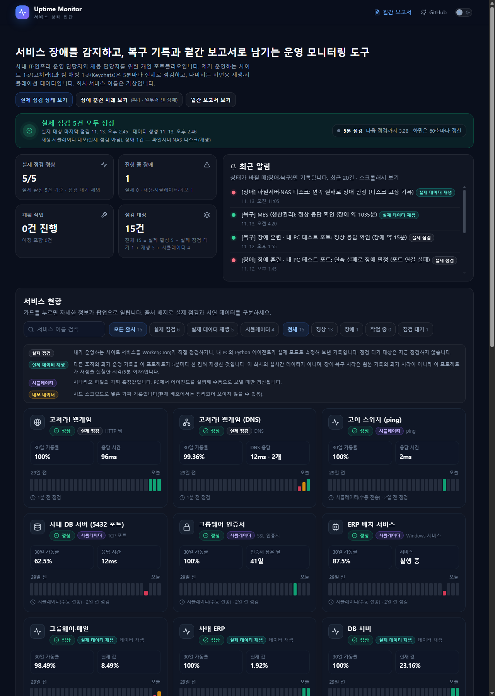
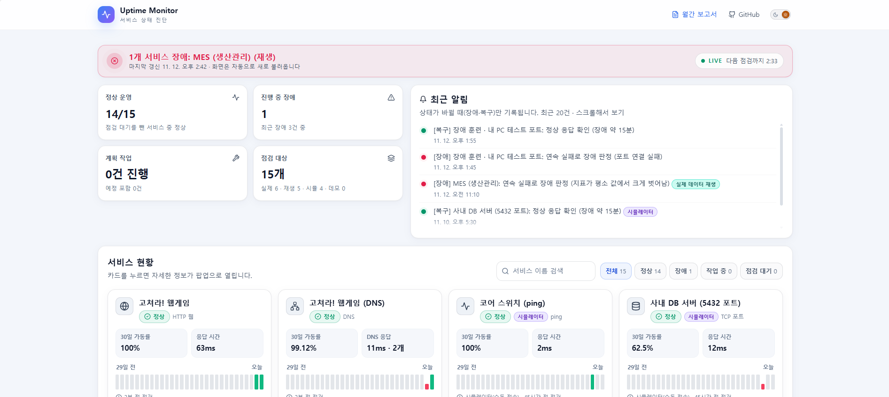
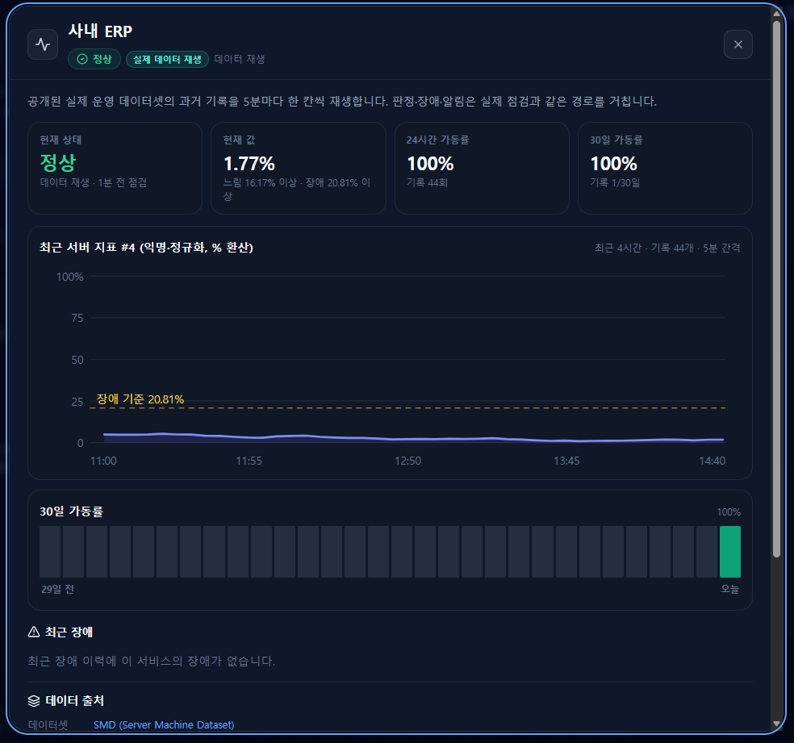
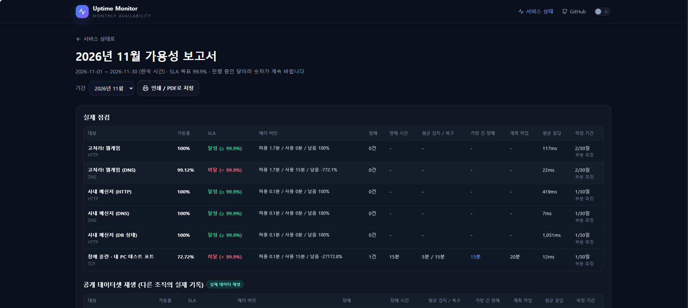
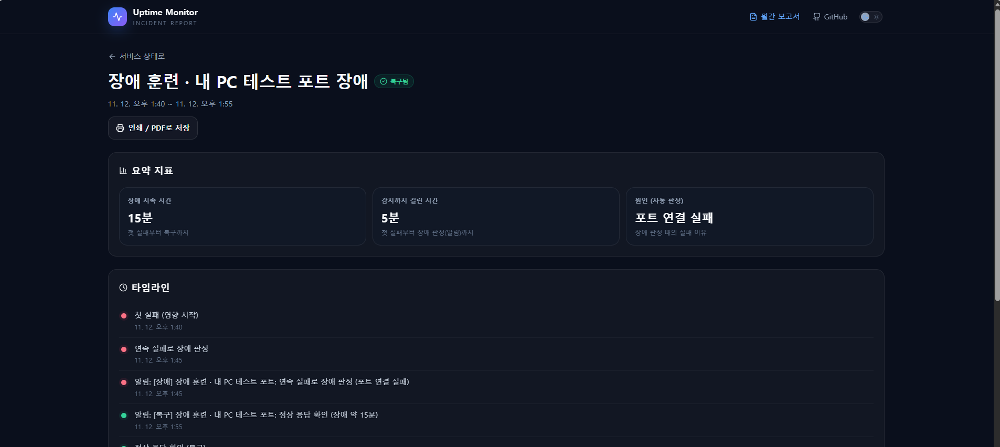
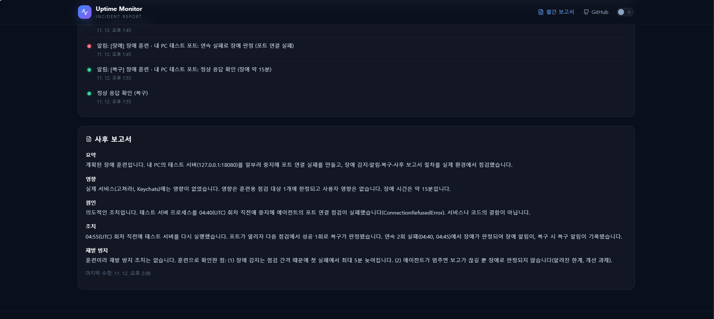
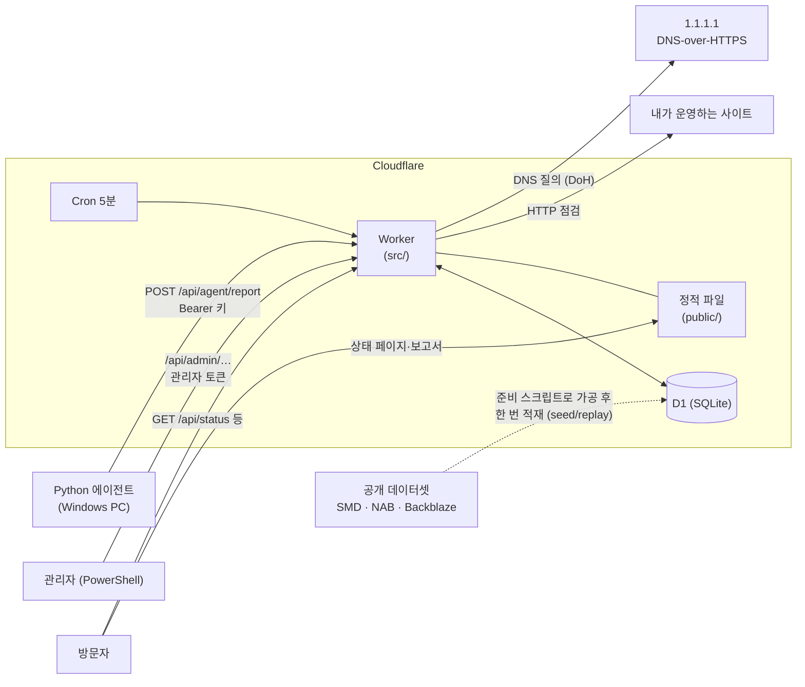

# Uptime Monitor · 서비스 상태 진단

[](https://github.com/Taetaeeee/uptime-monitor/actions/workflows/test.yml)

가상 회사의 웹 서비스와 사내 시스템을 5분마다 점검하고, 장애를 감지·기록하고,
가동률과 장애 이력을 **공개 상태 페이지**와 **월간 가용성 보고서**로 보여 주는 포트폴리오 프로젝트입니다.

- **상태 페이지 (라이브):** https://status-monitor.nalzzoaleph26.workers.dev
- **월간 보고서:** https://status-monitor.nalzzoaleph26.workers.dev/report.html

> 서비스와 회사 이름은 모두 가상입니다. 화면에는 **내가 운영하는 사이트(고쳐라!)와 팀이 만든 채팅(Keychats)의 실제 점검**, **공개 데이터셋(다른 조직의 실제 운영 기록, 과거)을 재생한 값**, **에이전트 시뮬레이터의 가짜 측정값**이 함께 있고, 카드마다 출처 배지가 붙습니다. 무엇이 실제이고 무엇이 가짜인지는 [아래 표](#실제-데이터와-가짜-데이터)에 정리했습니다.

## 30초 요약

- **무엇:** 서비스를 5분마다 점검해 장애를 감지·기록하고, 가동률과 장애 이력을 공개 상태 페이지·월간 보고서로 보여 주는 운영 도구. Cloudflare Workers + D1, 화면은 빌드 도구 없는 HTML/JS, 내부 점검은 Python 에이전트.
- **실제로 돌고 있는 것:** 내가 운영하는 사이트(고쳐라!)와 팀이 만든 채팅(Keychats)을 5분마다 실제 점검하고, 장애 훈련으로 "장애 → 알림 → 복구 → 사후 보고서" 흐름을 실제 환경에서 확인했습니다.
- **가짜·재생인 것:** 나머지 서비스는 공개 데이터셋의 과거 기록 재생(`replay`)과 에이전트 시뮬레이터(`simulator`)이고, 모든 카드에 출처 배지가 붙습니다. 실제와 가짜를 합친 숫자는 만들지 않습니다.
- **검증:** 판정·계산 로직을 순수 함수로 분리해 JS 212개·Python 22개 테스트가 CI에서 돕니다. 판정 규칙의 성능은 설계에 쓰지 않은 데이터로 따로 측정했습니다(서버 지표에서 탐지율 44.7%, 오탐 시계열당 하루 0.81건). 이 수치가 이 서비스의 HTTP 점검 성능은 아니라는 점까지 [적어 두었습니다](#판정-규칙-성능-측정).
- **한계:** 에이전트 무응답 감지는 대상마다 켜야 하고 아직 켠 대상이 없음, 점검 정밀도 5분, 도메인 만료는 판정 로직만 ([전체 한계](#알려진-한계와-다음-과제)).

## 화면

| 상태 페이지 (어두운 화면, 기본) | 상태 페이지 (밝은 화면) |
|---|---|
|  |  |

| 서비스 상세 팝업 (공개 데이터셋 재생 대상) | 월간 가용성 보고서 |
|---|---|
|  |  |

| 장애 상세: 요약 지표와 타임라인 | 장애 상세: 사후 보고서 |
|---|---|
|  |  |

화면 속 "(재생)"·"실제 데이터 재생" 표시는 공개 데이터셋을 재생한 값이라는 뜻이고, "장애 훈련" 항목은 일부러 낸 훈련입니다([장애 훈련 기록](#장애-훈련-기록)).

## 무엇을 하나

| 기능 | 내용 |
|---|---|
| 외부 점검 | Cloudflare Worker 예약 실행(Cron, 5분)으로 HTTP 상태 코드·응답 시간·키워드, DNS(DNS-over-HTTPS로 이름 풀림·기대값) 점검. 도메인 만료는 판정 로직만 ([한계](#알려진-한계와-다음-과제) 참고) |
| 내부 점검 | Windows PC의 Python 에이전트가 ping·TCP 포트·SSL 만료·디스크·서비스 상태를 측정해 API로 보고 (바깥으로만 연결) |
| 공개 데이터셋 재생 | SMD(서버 지표)·NAB(설비 온도)·Backblaze(디스크) 공개 데이터의 과거 기록을 5분마다 한 칸씩 재생해 서버 지표·설비·디스크 서비스를 보여 줌. 실제 점검과 **같은 판정·알림·집계 경로**를 타고, 출처는 `replay` |
| 장애 판정 | 2회 연속 실패 → 장애, 1회 성공 → 복구. 상태가 바뀔 때만 알림 기록 |
| 장애 이력·보고서 | 장애 1건마다 첫 실패·판정·복구 시각, 감지 시간(MTTD)·복구 시간(MTTR), 사후 보고서 5항목 |
| 계획 작업 | 미리 등록한 작업 시간의 점검은 장애로 보지 않고 가동률에서 제외 |
| 상태 페이지 | 한 줄 상태 띠와 LIVE 표시(다음 점검까지 카운트다운), 요약 카드·최근 알림, 서비스 현황(30일 막대·"N분 전 점검"·상태가 바뀐 카드 강조), 카드를 누르면 상세 팝업(최근 24시간 응답 시간·측정값 그래프, 30일 가동률, 30일 일평균 응답), 장애 이력. 점검 회차 직후 자동으로 새로 불러옴 |
| 월간 보고서 | 대상별 가동률·SLA(99.9%) 달성·에러 버짓·장애 지표, 인쇄/PDF 저장 |
| 화면 테마 | 어두운 화면(기본, 업무용)과 밝은 화면(보고·공유용)을 헤더의 토글 스위치로 전환, 고른 값은 브라우저에 저장. 주소 끝 `?theme=light`로 열면 처음부터 밝은 화면 |

## 구성



점검 1회의 흐름 (Cron·에이전트 보고·데이터셋 재생이 모두 같은 경로 `src/record.js`를 사용):

```
측정 → 판정(순수 함수) → 계획 작업 확인 → 상태 전이(장애/복구)
    → [결과 + 상태 + 장애 이력] 한 batch 저장 → 알림(log 채널) → 일별 집계(KST)
```

재생은 "측정" 자리에서 네트워크 대신 D1의 `replay_series`에서 값을 읽습니다.
`지금 순번 = (지금 − 기준 시각) ÷ 간격`을 시계열 길이로 나눈 나머지이고, 끝까지 가면 처음부터 반복합니다(SMD·NAB는 약 1주 주기).

## 기술

- **Cloudflare Workers** (Cron + API + 정적 파일), **D1**(SQLite), **wrangler**
- 화면: 빌드 도구 없는 HTML/CSS/JS
- 판정·계산 로직은 순수 함수로 분리해 `node --test`로 테스트
- 에이전트: Python 3 표준 라이브러리만 사용
- 테스트: JS 212개, Python 22개 (원본 데이터 없이 CI에서도 돌아감)

## 주요 설계 판단

| 판단 | 이유 |
|---|---|
| 장애는 **2회 연속 실패**, 복구는 **1회 성공** | 일시적 흔들림으로 인한 오탐·알림 피로를 줄이고, 복구는 빨리 알려 장애 시간이 부풀지 않게 (감지는 최대 5분 늦어짐) |
| 점검 시각을 **5분 회차로 내림**해 저장 | Cron이 정각보다 몇 초 늦게 실행됨(실측 :12초). 회차 단위로 묶어 집계·비교 |
| 저장은 **UTC**, 하루·한 달은 **KST** | 기준을 하나로 저장하고, 사람이 보는 경계는 한국 시간으로 (서머타임 없음) |
| 에이전트는 **측정만**, 판정은 **서버** | 기준값을 한곳에서 관리, 에이전트가 여러 대여도 판정 일관 |
| 에이전트는 **바깥으로만 연결(push)** | PC에 들어오는 포트를 열지 않음. 대신 에이전트가 멈추면 보고가 끊김(아래 한계 참고) |
| 결과·상태·장애 이력을 **한 batch**, 알림은 **저장 후** | 기록끼리 어긋나지 않게 하고, 알림 실패가 점검 기록을 막지 않게 |
| 모든 기록에 **출처(source)** + DB CHECK 제약 | 실제·가짜 데이터가 섞여 보이지 않게. 시뮬레이터 보고는 시뮬레이터 대상에만 기록 |
| 공개 데이터셋은 `simulator`·`real`을 재사용하지 않고 **새 출처 `replay`** | 다른 조직의 실제 기록은 "내 서비스의 실측"도 "가짜 측정값"도 아니라서, 어느 쪽으로 써도 화면이 거짓말을 하게 됨. SQLite는 CHECK를 못 바꿔 마이그레이션 0008에서 테이블을 다시 만들었고(자식→부모 순서로 지우고 부모→자식 순서로 복원, 적용 전 백업), 데이터가 든 DB에 적용하는 테스트로 검증 |
| 재생 값도 **같은 판정·알림 경로** | 실측과 재생이 다른 규칙을 타면 비교가 의미 없음. "연속 2회"는 `state.js` 한 곳에서만 세고, 재생은 값 하나가 실패인지만 판정. DB 경로의 알림·장애 건수가 순수 계산과 정확히 같은지 테스트로 비교 |
| 판정 기준값은 **라벨 없이 값의 분포로** | 이상 라벨을 판정에 쓰면 정답을 보고 푸는 것이라 이후 성능 측정이 무의미해짐. 기준값은 시계열의 95·99% 지점과 중앙값으로 정함 |
| 재생 설정은 `monitors`가 아니라 **`replay_config` 표** | 모든 종류가 쓰는 넓은 표에 재생 전용 값(시작 기준 시각·규칙·평소 값 …)을 붙이면 대부분의 행이 비게 됨. 단위는 코드가 짐작하지 않고 데이터(`unit`)에 기록 |
| 가동률은 **내림** 표시, 기간 가동률은 **점검 수 합계**로 | 99.99…%가 100%로 보이지 않게, 날짜별 % 평균의 왜곡 방지 |
| 계획 작업 중 점검은 **기록하되 가동률·판정에서 제외** | SLA의 일반 규칙. 남용 방지를 위해 최대 24시간·소급 등록 금지 |
| 에이전트 키와 관리자 토큰 **분리**, 타이밍 안전 비교 | 최소 권한, 키 추측 공격 방지 |

## 실제 데이터와 가짜 데이터

모든 기록(점검 결과·상태·알림·장애·집계·작업)에 출처가 남고, 화면과 보고서에 표시됩니다.
보고서는 출처별로 따로 보여 주며 **실제와 가짜를 합친 숫자는 만들지 않습니다.**

| 출처 | 무엇 | 어떻게 들어가나 | 화면 표시 |
|---|---|---|---|
| `real` | **고쳐라! 웹게임**(`gochyeora.pages.dev`, 내가 운영하는 사이트)의 HTTP 점검과 DNS 점검 | Worker Cron, **5분마다 실제 점검** (2026-11-11부터) | 표시 없음 |
| `real` | **사내 메신저**(= [Keychats](https://github.com/Nalzzo-ALEPH26/SKT_ALEPH_KEYCHATS), 학원에서 쓰려고 팀이 만든 채팅 사이트)의 점검 3종: HTTP(첫 화면), DNS, DB 상태(`/chats/api/health`) | Worker Cron, **5분마다 실제 점검** (2026-11-12부터). 상태 확인 주소는 Keychats 쪽에서 DB를 1번 조회해 `ok`/`error`만 돌려주며 사용자·채널·메시지는 건드리지 않음 | 표시 없음 |
| `real` | 관리자가 등록한 '모든 대상' 계획 작업 | 관리자 API | 표시 없음 |
| `replay` | 공개 데이터셋을 재생한 서비스 5개: 그룹웨어·메일, 사내 ERP, DB 서버(SMD 장비 3대), MES(NAB 설비 온도), 파일서버·NAS 디스크(Backblaze). **다른 조직의 실제 운영 기록(과거)**이며 이 회사의 실시간 데이터가 아님 | `scripts/prepare-datasets`로 가공한 `seed/replay/*.sql`을 한 번 적재, Worker Cron이 5분마다 한 칸씩 재생 | **실제 데이터 재생** 배지, 서비스를 누르면 데이터셋·라이선스·가공 방법 |
| `simulator` | 가상 내부 장비 4개(코어 스위치·DB 서버 5432 포트·인증서·ERP 배치)의 측정값과 그로 인한 장애·알림 | `seed/simulator-monitors.sql`로 대상 등록 → `agent/agent.py --simulate`로 시나리오 전송(PC에서 실행할 때만 갱신) | **시뮬레이터**, 시간 표시 앞에 "시뮬레이터(수동 전송)" |
| `sample` | 로컬 개발·테스트용 시드(`seed/sample.sql`). 가상 서비스 3개와 도메인 만료 데모 1개 | **배포본에서는 정리함**(`seed/retire-demo.sql`, 2026-11-12). 가짜 데모를 공개 데이터 재생이 대체 | **데모 데이터** (배포본에는 없음) |

- 시뮬레이터의 주소는 `.invalid`(RFC 2606 예약 도메인)라 실제로 접속될 수 없고, 값은 시나리오 파일의 가짜 측정값입니다.
- 에이전트의 실제 모드는 **장애 훈련용 점검 1개**(내 PC의 `127.0.0.1:18080` 포트)로만 전송해 검증했습니다([장애 훈련 기록](#장애-훈련-기록)). 내 PC의 디스크·서비스 같은 다른 정보는 공개 화면에 올리지 않기로 했습니다.
- **재생은 가짜가 아니지만 이 회사의 데이터도 아닙니다.** 그래서 보고서에서 다른 출처와 합산하지 않고, 화면의 장애도 "재생 중 열린 장애"로 읽어야 합니다.

### 공개 데이터셋 (재생)

| 데이터셋 | 사용한 것 | 라이선스·조건 (원본에서 직접 확인) | 가공 |
|---|---|---|---|
| [SMD](https://github.com/NetManAIOps/OmniAnomaly) (Server Machine Dataset) | 장비 3대(`machine-1-1`·`2-1`·`3-1`)의 test 구간 중 이상 구간이 많은 1주, 지표 1개씩 | MIT (`ServerMachineDataset/LICENSE`, 2026-11-12 확인) | 1분 값을 5분 **최댓값**으로 줄임(2,016칸). 값은 0~1 정규화 상대값을 %로 환산한 것으로 **실제 사용률이 아님**. 지표 이름은 공개되지 않아 "서버 지표 #N(익명·정규화)"로 표시 |
| [NAB](https://github.com/numenta/NAB) (Numenta Anomaly Benchmark) | `realKnownCause/machine_temperature_system_failure.csv`의 라벨 창 2개(2013-12-10 ~ 12-17)와 앞뒤 12시간 | MIT 형식 (`LICENSE.txt`, 2026-11-12 확인) | 5분 간격 원본 그대로(2,432칸). 값의 단위는 원본이 밝히지 않아 숫자만 표시 |
| [Backblaze Drive Stats](https://www.backblaze.com/cloud-storage/resources/hard-drive-test-data) | 2013년 데이터에서 같은 모델 드라이브 8대(고장 2대·정상 6대), 60일 | **MIT가 아님.** 공식 페이지의 자체 조건: 출처를 Backblaze로 표기, 사용 책임은 사용자, 파생물 판매는 가능하나 데이터 자체는 판매 불가 (2026-11-12 확인) | 8대의 불량 섹터(`smart_5_raw`) 합계를 하루 1칸으로 사용. 드라이브 시리얼 번호는 기록하지 않음 |

원본(수십 MB)은 저장소에 올리지 않고, 가공한 작은 조각(약 160KB)만 `seed/replay/`에 둡니다. 가공·재현 방법은 [scripts/prepare-datasets/README.md](scripts/prepare-datasets/README.md).
인용: Backblaze Drive Stats(backblaze.com), NAB — Ahmad, Lavin, Purdy, Agha, *Unsupervised real-time anomaly detection for streaming data*, Neurocomputing 2017 (arXiv:1510.03336).
SMD의 논문 인용은 저장소 README에서 찾지 못해 비워 두었습니다.

## 장애 훈련 기록

실제 서비스(고쳐라!, Keychats)를 건드리지 않고 "장애 감지 → 알림 → 복구 → 사후 보고서"와 계획 작업 처리를 실제 환경에서 확인한 훈련입니다. 2026-11-12에 했습니다.

**방법:** 내 PC에서 테스트 서버(`python -m http.server 18080 --bind 127.0.0.1`, 내 PC에서만 열림)를 켜 두고, Python 에이전트(**실제 모드**, 설정은 저장소 밖 임시 파일)가 그 포트의 연결 여부를 5분마다 보고합니다. 서버를 끄고 켜는 것으로 장애를 만들었습니다. 점검 대상 `장애 훈련 · 내 PC 테스트 포트`는 마이그레이션 0012로 등록했고, 이름에 '훈련'을 넣었으며, 훈련이 끝난 뒤 비활성(점검 대기)으로 돌렸습니다. 장애 기록·보고서·계획 작업 기록은 화면에 그대로 남아 있습니다.

### 훈련 A: 장애 → 알림 → 복구 → 사후 보고서 (장애 #41)

| 시각 (한국 / UTC) | 일어난 일 |
|---|---|
| 13:30 ~ 13:35 / 04:30 ~ 04:35 | 정상 2회 |
| 13:36 ~ 13:41 사이 | 테스트 서버 중지 (정상 2회를 확인한 직후) |
| 13:40 / 04:40 | 첫 실패 (`ConnectionRefusedError`), 장애 시작 시각으로 기록 |
| 13:45 / 04:45 | 두 번째 연속 실패 → **장애 판정**, 알림 기록 ("포트 연결 실패") |
| 13:51 ~ 13:56 사이 | 테스트 서버 재실행 (13:50 회차까지는 실패) |
| 13:55 / 04:55 | 재실행 후 첫 점검 성공 1회 → **복구 판정**, 복구 알림 기록 |

| 지표 | 값 |
|---|---|
| 장애 지속 시간 | 15분 (첫 실패부터 복구까지) |
| 감지까지 걸린 시간 | 5분 (연속 2회 규칙: 첫 실패에서 판정까지) |
| 출처 | `real` (에이전트 실제 모드) |

장애 상세와 사후 보고서 5항목(요약·영향·원인·조치·재발 방지)은 관리자 API로 작성했습니다. 보고서에는 계획된 훈련이라고 적었습니다.
- PDF: [장애 #41 상세·사후 보고서](docs/drills/drill-a-incident-41.pdf), [2026년 11월 월간 보고서](docs/drills/drill-monthly-report-2026-11.pdf)
- 화면: [타임라인](docs/screenshots/incident-41-timeline.png), [사후 보고서](docs/screenshots/incident-41-report.png)

### 훈련 B: 계획 작업 중에는 장애로 보지 않음

14:15 ~ 14:35(한국 시간, 20분)을 계획 작업으로 등록하고, 그 시간에 테스트 서버를 다시 껐습니다.

| 시각 (한국) | 결과 |
|---|---|
| 14:11 | 정상 (작업 시작 전) |
| 14:15 | 대상 상태가 **계획 작업 중(`maintenance`)**으로 바뀜 |
| 14:16, 14:21, 14:26, 14:31 | 점검 실패 4번, 모두 "작업 중"으로 기록, **장애·알림 없음** |
| 14:35 | 작업 종료, 상태 `up`으로 복귀 |
| 14:36 | 작업 시간 밖의 정상 점검으로 기록 |

월간 보고서에서 작업 중 4번의 실패는 **점검 수와 가동률 계산에서 제외**되었고, 계획 작업 시간은 20분으로 집계되었습니다.

### 훈련에서 확인한 것과 한계

- 감지는 점검 간격(5분)과 연속 2회 규칙 때문에 첫 실패에서 최대 5분 늦어집니다. 복구는 성공 1회로 바로 판정됩니다.
- 훈련 당시에는 에이전트가 멈추면 장애로 판정되지 않고 보고가 끊길 뿐이었습니다. 훈련 B 이후 에이전트를 끄자 점검 기록이 더 이상 쌓이지 않은 것으로 확인했고, 이 한계는 이후 [무응답 감지](#에이전트-무응답-감지)(0013)로 보완했습니다(대상마다 켜야 함).
- 이 장애는 **내가 일부러 낸 것**이라 서비스 품질의 증거가 아니라 **기능이 의도대로 동작한다는 증거**입니다. 훈련 대상의 가동률이 낮게 나오는 것은 그래서입니다.
- 에이전트는 내 PC의 `127.0.0.1` 훈련 포트 하나만 보고했고, 실제 모드의 다른 점검(디스크·서비스·ping 등)은 이번에 쓰지 않았습니다.

## 판정 규칙 성능 측정

"연속 2회 실패면 장애"라는 규칙이 실제로 얼마나 잘 맞는지, 라벨(정답)이 있는 공개 데이터로 재 봤습니다. 표 전체는 [docs/evaluation/results.md](docs/evaluation/results.md)에 있고, 이 절은 읽는 법과 결론입니다.

### 어떻게 쟀나

- **운영 판정 함수 그대로:** 값 하나를 정상·실패로 가르는 `judgeReplay`는 운영 코드를 import해서 썼습니다. 연속 N회 규칙은 운영 `state.js`의 상수(2)를 바꾸지 않으려고 같은 규칙을 측정 스크립트에 따로 두었고, **N=2일 때 운영 상태 머신과 똑같이 움직이는지 무작위 흐름 50개로 비교하는 테스트**를 넣었습니다.
- **선택 편향 피하기:** 상태 페이지에 쓴 서버·파일(SMD 1-1, 2-1, 3-1, NAB machine_temperature)은 지표와 기준값을 정할 때 이미 본 데이터라서 공식 결과에서 뺐습니다. 공식 결과는 **다른 서버 3대(SMD 1-2, 2-2, 3-2)와 다른 NAB 파일 3개**에서만 냈습니다. SMD는 지표를 라벨 보고 고르지 않고 38개를 **전부** 평가해 합쳤습니다.
- **시간 순서 분할:** 시계열마다 앞 30%로 임계값(값의 99% 지점)을 정하고(라벨 안 씀), 뒤 70%에서만 점수를 냈습니다.
- **지표:** 탐지율(이상 구간 중 알림이 울린 비율), 오탐(어떤 이상 구간과도 안 맞는 알림), 지연(이상 구간 시작 → 첫 알림). 알림이 이상 구간의 앞뒤 15분 안에 있으면 맞은 것으로 봤습니다.

### 결과 (SMD 서버 지표, 시계열 83개 · 이상 구간 123건, 값 상위 99% 기준)

| 연속 실패 | 탐지율 | 오탐/시계열·일 | 알림 정밀도 | 지연(중앙 / 90%) |
|---|---|---|---|---|
| 1회 | 85.4% (105/123) | 3.80 | 20.3% | 0분 / 55분 |
| **2회 (운영)** | **44.7% (55/123)** | **0.81** | 19.8% | 5분 / 60분 |
| 3회 | 26.8% (33/123) | 0.27 | 24.9% | 10분 / 20분 |

- 1회 → 2회: 오탐이 약 79% 줄고(3.80 → 0.81), 탐지율은 40.7%p 떨어집니다. 지연 중앙값은 0분에서 5분이 됩니다.
- 2회 → 3회: 오탐은 67% 더 줄지만 탐지율이 17.9%p 더 떨어지고 지연 중앙값이 5분 더 늘어납니다.
- **정밀도는 연속 횟수를 바꿔도 20~25%에 머뭅니다.** 오탐이 "한 칸짜리 튀는 값"이 아니라 몇 칸씩 이어지는 값이라 연속 횟수로는 걸러지지 않는다는 뜻입니다.
- 임계값을 95% → 99.9%로 올려도 연속 2회에서 오탐은 2.12 → 0.85로 줄다 99%부터 거의 멈춥니다(0.81~0.85). 평가 구간에서 평소 수준이 앞 30%와 달라진 시계열이 있어서일 가능성이 있지만, 이번에 원인을 확인하지는 않았습니다.
- **라벨을 보고 서버마다 지표를 골랐다면** 같은 규칙으로 탐지율 83.3%(5/6, 이벤트가 6건뿐)에 오탐 0.06으로 나옵니다. 전체 평균(44.7%, 0.81)과 비교하면 **지표 선택만으로 점수가 이렇게 부풀 수 있습니다.** 상태 페이지의 재생 카드는 이렇게 골랐으므로 그 카드의 성능을 서비스 성능으로 읽으면 안 됩니다.
- NAB(검증 파일 3개, 이상 창 6개)는 표본이 너무 작아 규칙 우열을 말할 수 없습니다. ±10%(연속 2회)는 6개를 다 잡지만 시계열당 하루 오탐이 3.6건이고, `cpu_utilization` 파일 하나가 연속 2회·±20%에서 오탐 899건을 냈습니다(원인은 확인하지 않음).

### 이 결과로 말할 수 있는 것과 없는 것

- **말할 수 있는 것:** 잡음이 많은 연속 값(서버 지표)에서 연속 횟수를 늘리면 오탐은 크게 줄고 탐지율과 지연이 나빠지는 교환 관계가 있고, 운영의 2회는 그 중간입니다.
- **말할 수 없는 것:** 이 서비스의 HTTP 점검이 실제 장애를 몇 % 잡는지. 공개 라벨 데이터는 서버 지표·센서 값이지 "응답 없음"이 아니어서, HTTP처럼 성공·실패가 뚜렷한 점검에서는 연속 2회의 효과가 훨씬 깔끔할 것으로 예상하지만 **이번 데이터로 검증하지 못했습니다.**

### 한계

- **구간 단위 평가:** 이상 구간 안에서 한 번만 맞춰도 탐지로 칩니다. 지연을 함께 보고하는 이유입니다.
- **표본이 독립적이지 않음:** 한 서버의 여러 지표는 같은 이상 구간을 공유하므로 123건은 서로 독립인 123건이 아닙니다. 독립적인 표본 수는 이보다 훨씬 적습니다(얼마나 적은지는 계산하지 않았습니다).
- **지표별 정답은 해석 라벨에서:** SMD의 `interpretation_label`을 이용해 지표마다 잡아야 할 구간을 정했는데, 지표 번호가 1부터인지는 원본 설명으로 확인하지 못해 1부터라고 **가정**했습니다. 틀렸다면 지표별 이벤트 배정이 어긋납니다(전체 이상 구간 기준의 오탐 판정은 영향이 없습니다).
- **라벨이 완전하지 않을 수 있음:** 라벨에 없는 진짜 이상은 오탐으로 셉니다.
- **기준값에 이상 구간이 섞일 수 있음:** 앞 30%에도 이상이 있을 수 있고, 운영도 같은 방식이라 그대로 두었습니다. 값이 거의 상수인 시계열 31개(114개 중)는 규칙을 만들 수 없어 모든 규칙에서 뺐습니다.
- **NAB `ambient_temperature`는 점검 간격이 60분**이라 "연속 2회"가 2시간입니다. 지연·일수는 분 단위로 맞췄습니다.
- 허용 15분, 앞 30%, 99% 지점은 정한 값이지 최적화한 값이 아닙니다.

### 다시 돌리려면 (Windows PowerShell)

```powershell
node scripts/prepare-datasets/fetch.mjs            # 7c에서 받은 원본 (이미 있으면 건너뜀, 저장소 밖 폴더)
node scripts/evaluate-rules/fetch-heldout.mjs      # 검증용 원본 추가 (서버 3대 + NAB 3개, 약 25MB)
node scripts/evaluate-rules/run.mjs                # docs/evaluation/results.md·results.json 갱신
```

## 에이전트 무응답 감지

에이전트는 바깥으로만 연결하므로, 에이전트(또는 PC·네트워크)가 멈추면 서버에는 아무 일도 없는 것처럼 보입니다. 마지막 보고가 오래됐으면 이를 실패 점검(`agent_silent`, 화면 문구 "에이전트 보고 없음")으로 기록합니다.

- **켜는 방식:** `monitors.stale_after_min`(분)이 있는 대상만 감시합니다. 기본은 NULL(꺼짐)이라 0013을 적용해도 화면과 판정이 바뀌지 않습니다. 시뮬레이터 대상은 내가 수동으로 보낼 때만 갱신되어, 일괄로 켜면 가짜 무응답 장애가 계속 생기기 때문입니다.
- **판정:** 마지막 *실제 보고* 회차로부터 지난 분이 기준을 **넘으면** 무응답입니다. 기준 15분이면 마지막 보고 뒤 20분 회차에 첫 실패, 연속 2회 규칙으로 25분 회차에 장애 판정입니다(딱 15분은 한 회차 여유). 보고가 다시 오면 기존 규칙(성공 1회)으로 복구됩니다.
- **같은 경로 재사용:** 새 판정 경로를 만들지 않고 `record.js`에 실패 점검을 넘깁니다. 알림·장애 이력·계획 작업 제외·일별 집계가 그대로 적용됩니다.
- **한 번도 보고한 적 없는 대상은 판정하지 않습니다.** 새로 등록하자마자 장애로 뜨는 것을 막기 위해서입니다.

한계: (1) 에이전트가 멈춘 것인지 PC가 꺼진 것인지 서버는 구분할 수 없습니다. (2) 무응답 구간은 실패 점검으로 쌓여 가동률이 내려갑니다("확인하지 못한 시간"을 장애로 보는 보수적 선택). (3) 무응답이 기록된 회차에 같은 회차의 보고가 늦게 오면 그 보고는 중복 방지 규칙으로 건너뛰고, 다음 회차 보고부터 받습니다(복구가 최대 5분 늦어질 수 있음, 테스트로 확인). (4) 지금은 켠 대상이 없고, 원격 환경에서 켜 보는 검증은 하지 않았습니다.

켜는 예시(마이그레이션 0013을 적용한 뒤, 대상의 `check_key`는 직접 정합니다):

```powershell
npx.cmd wrangler d1 execute status-monitor-db --remote --command "UPDATE monitors SET stale_after_min = 15 WHERE check_key = '<대상 키>'"
```

## 폴더 구조

```
src/            Worker 코드
  index.js        진입점 (Cron, HTTP 경로)
  checker.js      HTTP 측정        judge.js       HTTP·DNS·도메인 만료 판정
  dns.js          DNS 측정 (DNS-over-HTTPS)
  agent-judge.js  에이전트 보고 검증·판정
  state.js        장애 판정(상태 전이)   record.js  기록 공용 경로
  notify.js       알림 발송         channels/log.js  log 채널 (D1 기록)
  aggregate.js    일별 집계·가동률   report.js  월간 보고서 계산
  incident.js     장애·계획 작업 계산  time.js   회차 시각
  ingest.js       에이전트 보고 API  admin.js  관리자 API
  api.js          공개 조회 API     auth.js   토큰 확인   db.js  SQL 모음
  replay.js       재생 계산(순수 함수): 순번·5분 변환·집계·판정
  replay-run.js   Cron 재생 실행: 대상·값 읽기 → 판정 → record.js
  stale.js        에이전트 무응답 판정(순수 함수)   stale-run.js  Cron 무응답 실행 → record.js
public/         상태 페이지, 장애 상세, 월간 보고서 (HTML/CSS/JS)
migrations/     D1 스키마 (0001 ~ 0013; 0008 replay 출처, 0009 재생 설정, 0010 단위, 0011 사내 메신저 점검 등록, 0012 장애 훈련 대상, 0013 무응답 감시 기준)
docs/           장애 훈련 PDF(drills/), README용 스크린샷(screenshots/), 판정 규칙 성능 측정 결과(evaluation/)
seed/           sample.sql(로컬·테스트용), simulator-monitors.sql, retire-*.sql(정리), replay/(공개 데이터셋 재생용 SQL·manifest·unload.sql)
scripts/        prepare-datasets/ (원본 내려받기·분석·가공), evaluate-rules/ (판정 규칙 성능 측정)
agent/          Python 에이전트 + 시뮬레이터 시나리오 + 테스트
test/           node --test (가짜 D1: Node 내장 SQLite에 실제 마이그레이션 적용)
```

## 실행 방법 (Windows PowerShell)

> PowerShell 실행 정책 때문에 `npm`·`npx` 대신 `npm.cmd`·`npx.cmd`를 씁니다.

### 테스트
```powershell
npm.cmd install
npm.cmd test                                     # JS 212개
python -m unittest discover -s agent\tests       # Python 22개
```

### 처음 배포
```powershell
npx.cmd wrangler login                           # 계정 인증 (직접)
npx.cmd wrangler d1 create status-monitor-db     # 나온 database_id를 wrangler.jsonc에
npm.cmd run db:migrate:remote                    # 마이그레이션 0001 ~ 0013
npx.cmd wrangler d1 execute status-monitor-db --remote --file=seed/simulator-monitors.sql
npx.cmd wrangler secret put AGENT_API_KEY        # 에이전트 키 (직접 생성)
npx.cmd wrangler secret put ADMIN_TOKEN          # 관리자 토큰 (에이전트 키와 다른 값)
npm.cmd run deploy
npx.cmd wrangler tail                            # 5분마다 점검 로그
```

비밀 값을 만드는 예:
```powershell
$bytes = New-Object byte[] 32; [Security.Cryptography.RandomNumberGenerator]::Create().GetBytes($bytes); [Convert]::ToBase64String($bytes)
```
비밀 값은 코드·저장소에 넣지 않습니다. 로컬은 `.dev.vars`(`.gitignore` 대상, 예시는 `.dev.vars.example`).

### 실제 사이트 점검 켜기
```powershell
npx.cmd wrangler d1 execute status-monitor-db --remote --command "UPDATE monitors SET is_active = 1 WHERE url IN ('https://gochyeora.pages.dev', 'dns://gochyeora.pages.dev')"
```

### Keychats 점검 켜기
점검 대상은 마이그레이션 0011이 **비활성**으로 등록해 둡니다. 켜기 전에 Keychats의 상태 확인 주소가 정상인지 먼저 확인합니다(없으면 DB 상태 점검이 계속 실패).
```powershell
curl.exe -s https://keychats.vercel.app/chats/api/health        # {"status":"ok"} 가 나와야 함
npx.cmd wrangler d1 execute status-monitor-db --remote --command "UPDATE monitors SET is_active = 1 WHERE name LIKE '사내 메신저%' AND source = 'real'"
```

### 공개 데이터셋 재생 올리기 · 되돌리기
적재 전에 백업을 받고(`wrangler d1 export status-monitor-db --remote --output=<파일>`), 아래 순서로 실행합니다.
```powershell
npx.cmd wrangler d1 execute status-monitor-db --remote --file=seed/replay/datasets.sql
npx.cmd wrangler d1 execute status-monitor-db --remote --file=seed/replay/monitors.sql
npx.cmd wrangler d1 execute status-monitor-db --remote --file=seed/replay/series-replay-smd-1-1.sql   # series-*.sql 5개 모두
```
`monitors.sql`은 다시 실행해도 시작 기준 시각을 바꾸지 않고(재생이 처음으로 되돌아가지 않음), 첫 이상이 적재 후 약 1시간에 나오도록 기준 시각을 잡습니다.
**되돌리기(재생 대상만 제거):** `seed/replay/unload.sql`을 같은 방식으로 실행합니다. real·simulator 데이터는 건드리지 않습니다.
원본 내려받기·가공 방법은 [scripts/prepare-datasets/README.md](scripts/prepare-datasets/README.md).

### 에이전트 · 시뮬레이터
```powershell
python agent\agent.py --config agent\config.example.json --once --dry-run   # 이 PC 측정만 (전송 없음)
$env:AGENT_API_KEY = "<에이전트 키>"
python agent\agent.py --simulate agent\scenarios\db-outage.json --api-url https://<Worker 주소>/api/agent/report
```
자세한 내용: [agent/README.md](agent/README.md)

### 관리자 API (보고서 작성 · 계획 작업)
```powershell
$b = "https://<Worker 주소>"
$h = @{ Authorization = "Bearer $env:ADMIN_TOKEN" }
$body = @{ summary = '요약'; root_cause = '원인'; action = '조치'; prevention = '재발 방지' } | ConvertTo-Json
Invoke-RestMethod -Method Put -Uri "$b/api/admin/incidents/<장애 번호>/report" -Headers $h `
  -ContentType 'application/json; charset=utf-8' -Body ([Text.Encoding]::UTF8.GetBytes($body))

$w = @{ monitor_id = <대상 번호>; title = '작업 이름'; starts_at = '2026-11-20T22:00:00+09:00'; ends_at = '2026-11-20T23:00:00+09:00' } | ConvertTo-Json
Invoke-RestMethod -Method Post -Uri "$b/api/admin/maintenance" -Headers $h `
  -ContentType 'application/json; charset=utf-8' -Body ([Text.Encoding]::UTF8.GetBytes($w))
Invoke-RestMethod -Method Delete -Uri "$b/api/admin/maintenance/<작업 번호>" -Headers $h
```
시각에는 반드시 시간대(`+09:00` 또는 `Z`)를 붙입니다. 없으면 거부합니다(한국 시간/UTC 혼동 방지).

## API

| 경로 | 인증 | 내용 |
|---|---|---|
| `GET /api/status` | 없음 | 상태 페이지 전체 (서비스·30일 막대·장애 이력·알림·계획 작업), 60초 캐시 |
| `GET /api/incidents/:id` | 없음 | 장애 상세·보고서·타임라인 |
| `GET /api/reports/monthly?month=YYYY-MM` | 없음 | 월간 가용성 보고서 (없으면 이번 달) |
| `GET /api/monitors/:id/history?hours=24` | 없음 | 상세 팝업 그래프용 최근 기록 (1~48시간), 60초 캐시 |
| `POST /api/agent/report` | 에이전트 키 | 에이전트 측정값 보고 (중복 회차는 건너뜀) |
| `PUT /api/admin/incidents/:id/report` | 관리자 토큰 | 보고서 작성·수정 |
| `POST /api/admin/maintenance` · `DELETE /api/admin/maintenance/:id` | 관리자 토큰 | 계획 작업 등록·취소 |

공개 응답에는 점검 대상의 주소(URL)를 넣지 않습니다.
`/api/status`의 재생 대상에는 `replay`(지표 설명·단위·판정 규칙·평소 값·데이터셋 키)가, 최상위에는 `datasets`(이름·링크·라이선스·가공 방법·인용)가 들어 있고, 재생 대상이 없으면 `datasets`는 `{}`입니다.

## 알려진 한계와 다음 과제

- **에이전트 무응답 감지는 대상마다 켜야 함:** 코드와 테스트는 있지만(아래 [설명](#에이전트-무응답-감지)) 기본은 꺼져 있고, 켠 대상이 아직 없습니다. 켜지 않은 대상은 에이전트가 멈춰도 보고가 끊길 뿐 장애로 판정되지 않습니다. 원격 DB에 0013을 적용하고 대상을 켜 보는 검증은 아직 하지 않았습니다.
- **정밀도 5분:** 점검 간격 때문에 감지·복구 시간과 장애 시간은 5분 단위입니다.
- **Cron 실행 지연:** 실행 시각이 정각보다 몇 초 늦어(실측 12초) 회차 내림으로 보정했습니다. 5분 넘게 늦으면 다음 회차로 묶입니다.
- **로컬 Worker 실행 불가:** 개발 PC의 Windows 스마트 앱 컨트롤이 `workerd.exe`를 차단해 `wrangler dev`를 쓰지 못했습니다. 보안 설정을 끄지 않고, D1과 같은 SQLite(Node 내장)에 실제 마이그레이션을 적용한 가짜 D1로 Cron·API 흐름 전체를 테스트하고 원격에서 확인했습니다.
- **도메인 만료는 판정 로직만:** 내 도메인이 없어서 실제 만료일 조회(RDAP/WHOIS)는 만들지 않았습니다. `judgeDomainExpiry`(30일 전부터 경고)를 가짜 날짜로 테스트하고, 화면에는 데모 대상 1개로만 보여 줍니다.
- **SLA 목표는 하나(99.9%):** 대상별 목표, CSV 내보내기, 보고서 자동 발송은 없습니다.
- **알림 채널은 log 하나:** 채널 구조(`{ name, send() }`)는 교체 가능하게 나눠 두었습니다. 외부 메신저는 쓰지 않습니다.
- **실제 데이터는 아직 짧음:** 고쳐라! 웹게임(HTTP·DNS) 실제 점검은 2026-11-11부터 시작해서, 30일 막대·월간 보고서의 실제 구간은 아직 며칠뿐입니다.
- **Keychats 점검의 범위:** 3종이 확인하는 것은 "첫 화면이 뜨는가(HTTP)", "이름이 풀리는가(DNS)", "Vercel 함수 → Supabase(PostgREST·Postgres)가 응답하는가(DB 상태)"입니다. 채팅 전송, 실시간 연결, 로그인, 파일 저장소가 정상인지는 확인하지 않으며, 실제 채팅에 가짜 메시지를 쌓거나 점검용 계정을 두어야 하는 종합 점검은 일부러 만들지 않았습니다. `keychats.vercel.app`은 내 도메인이 아니라서 DNS 점검은 Vercel의 이름 해석을 보는 것입니다(고쳐라!의 `pages.dev`와 같은 한계).
- **재생 데이터의 한계:**
  - SMD는 지표 이름이 공개되지 않아 "CPU"라고 부를 수 없고, 값도 정규화 상대값입니다. 지표는 **이상 라벨을 보고 골랐기 때문에**, 이 지표로 판정 성능을 재면 결과가 실제보다 좋게 나옵니다(선택 편향). 그래서 판정 기준값은 라벨 없이 시리즈의 95·99% 지점으로 정했고, 성능 측정(B-9)은 선택에 쓰지 않은 서버·파일로 했습니다(아래 "판정 규칙 성능 측정"). DB 서버(`machine-3-1`)는 이상 구간 3개 중 1개만 장애로 잡힙니다.
  - NAB 설비 온도에는 약 17시간 지속되는 실제 고장 구간이 들어 있어, 재생이 시작된 첫날 MES의 가동률이 낮게 나옵니다(데이터가 그렇습니다).
  - 재생은 1주(Backblaze는 60일) 주기로 반복하므로 같은 장애가 같은 간격으로 다시 나타납니다. 장애 발생 시각은 원본 시각이 아니라 재생 시계 기준입니다.
  - 라이선스는 원본에서 직접 확인한 것만 적었습니다. Loghub(연구·학술 목적)와 OTRF Security-Datasets는 용량·형식 조사가 끝나지 않아 아직 쓰지 않았습니다.
- **데모 장애 보고서 예시가 사라짐:** 사후 보고서가 있는 장애가 전부 가짜(`sample`)였고 배포본에서 정리해서, 지금은 완성된 사후 보고서 예시가 화면에 없습니다. 관리자 API로 쓰는 기능 자체는 테스트로 검증되어 있습니다.
- **부하:** 재생 대상 5개가 늘어 D1 사용량이 늘었습니다. 컷오버 직후 측정(`wrangler d1 info`, 24시간 합계)으로 정상 상태 쓰기는 회차당 약 40행(하루 약 1.2만 행으로 추정), 읽기는 회차당 약 1.8천 행(하루가 지나면 일별 집계 재계산 때문에 약 90만 행까지 늘 것으로 추정)입니다. 같은 계정의 다른 프로젝트와 한도를 나눠 쓰는지는 공식 문서에서 확인하지 못했습니다.
- **내 PC의 실제 측정값은 훈련용 포트 하나만 보냄:** 에이전트 실제 모드는 장애 훈련으로 검증했고(아래 훈련 기록), 디스크·서비스 같은 내 PC의 다른 측정값은 공개 상태 페이지에 올리지 않기로 해서 보내지 않습니다. 에이전트가 PC에서 계속 돌지도 않습니다(훈련 때 직접 실행하고 종료).

## 실제로 겪은 문제와 해결

작업 기록에 남아 있는 것만 적었습니다. 내 추측이 틀렸던 경우도 그대로 적었습니다.

| 문제 | 원인 | 해결과 배운 점 |
|---|---|---|
| 로컬에서 `wrangler dev`가 안 됨 | Windows 스마트 앱 컨트롤이 `workerd.exe`를 차단 | 보안 설정을 끄지 않고, D1과 같은 SQLite(Node 내장)에 **실제 마이그레이션을 적용한 가짜 D1**로 Cron·API 흐름 전체를 테스트. 최종 확인은 원격에서 |
| `npm`·`npx`가 실행되지 않음 | PowerShell 실행 정책이 `.ps1` 래퍼를 막음 | `npm.cmd`·`npx.cmd` 사용(README의 모든 명령에 반영) |
| `wrangler d1 create` 뒤 설정이 중복됨 | 명령이 `wrangler.jsonc`에 같은 D1 바인딩을 한 번 더 추가 | 파일을 복원하고 `database_id`만 반영. 계정 인증이 필요한 명령은 직접 실행하고 결과를 확인하는 규칙으로 |
| 점검 시각이 5분 경계에 안 맞음 | Cron이 정각보다 12초쯤 늦게 실행 | 저장할 때 **5분 회차로 내림**. 집계·비교가 회차 단위로 묶임 |
| D1 명령이 가끔 실패(오류 코드 7403·7500) | 일시적인 서비스 오류 | 다시 시도하면 성공. 적재 스크립트에는 재시도를 넣고, 실패하면 이유를 출력하고 멈추게 |
| 임계선 때문에 그래프가 쓸모없어짐 | 임계값이 데이터보다 훨씬 크면 y축이 임계값까지 늘어나 선이 바닥에 붙음 | 임계선이 축에 들어올 때만 포함하는 규칙(`thresholdInAxis`). 작은 그래프의 글자는 크기 옵션(`box`)으로 해결. %는 0~100으로 고정(급등 한 번에 200%까지 늘어남) |
| 데모 데이터가 시간이 지나면 오래돼 보임 | 시드는 넣은 시점 기준이라 "20시간 전 점검"처럼 보임 | 매일 갱신 → 같은 계정의 D1 한도를 나눠 쓰는 것이 걱정되어 **하루 1회**로 줄임 → 결국 공개 데이터 재생으로 대체하고 갱신 코드 제거 |
| 출처에 `replay`를 넣으려는데 DB가 거부 | SQLite는 `CHECK` 제약을 `ALTER`로 못 바꿈 | 테이블 7개를 다시 만듦. 외래 키 때문에 **자식 → 부모 순서로 지우고 부모 → 자식 순서로 복원**하도록 설계, 데이터가 든 DB에 적용하는 테스트와 적용 전 백업으로 위험을 줄임 |
| 데이터셋 라이선스를 잘못 알았음 | 요약 사이트를 믿고 "NAB는 AGPL일 수 있다"고 추측, 문서의 "Backblaze는 MIT"를 그대로 전달 | 원본 저장소·공식 페이지를 직접 읽어 확인: NAB는 MIT 형식, Backblaze는 자체 이용 조건. 확인한 날짜와 근거를 데이터셋 메타에 기록 |
| 판정 성능이 좋게 나올 수밖에 없는 구조 | SMD 지표를 "이상을 잘 잡는 것"으로 고르면 라벨을 본 선택 편향 | 판정 기준값은 라벨 없이 값의 분포로 정하고, 편향을 데이터셋 설명·README에 명시. 성능 측정은 선택에 쓰지 않은 구간으로 |
| 원본 내려받기가 "받은 크기가 다릅니다"로 중단 | HEAD의 `Content-Length`가 압축된 크기 | 압축 없이(`accept-encoding: identity`) 요청 |
| Keychats 상태 확인 주소 경로를 잘못 잡음 | `/api/health`로 계획했지만 앱이 `basePath: '/chats'`를 써서 모든 경로가 `/chats` 아래 | 공개 저장소의 설정 파일을 읽고 `/chats/api/health`로 정정. 코드를 보기 전의 "404"는 근거가 되지 않음 |
| 상단 배너에 장애가 41시간째 남음 | 에이전트가 멈춘 채로 시뮬레이터 장애가 열려 있고, 닫아 줄 보고가 오지 않음 | 대체된 디스크 시뮬레이터를 정리. DB 포트 시뮬레이터는 시나리오가 의존해서 유지. 재생 장애는 배너 이름 뒤에 "(재생)" 표시 |

## 공식 문서에서 다시 확인할 부분

> 확인 완료: Worker 안에서 DoH(`cloudflare-dns.com`) 조회가 동작함 — 2026-11-11 실제 DNS 점검을 켠 첫 회차에서 응답 49ms·레코드 2개 기록.

Cloudflare 설정은 버전에 따라 바뀔 수 있어, 확인하지 못한 것은 추측하지 않고 표시해 두었습니다.

- 무료 플랜의 Cron 개수 제한, D1 읽기·쓰기 한도 수치와 계정 공유 여부
- D1 `batch`의 트랜잭션 동작, 마이그레이션 파일이 한 번에(원자적으로) 실행되는지, 한 문장의 최대 길이
- 정적 파일(`assets`)의 `.html` 리다이렉트 등 기본 동작 (배포본에서 `/incident.html` → `/incident` 307 확인)
